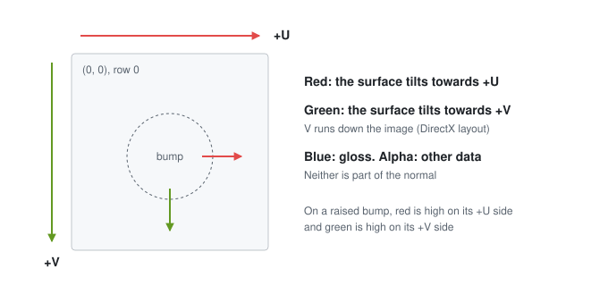
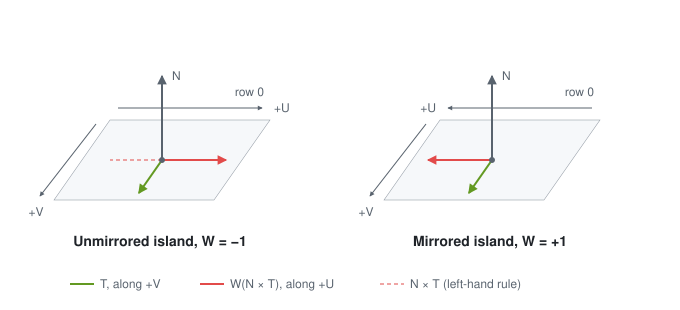
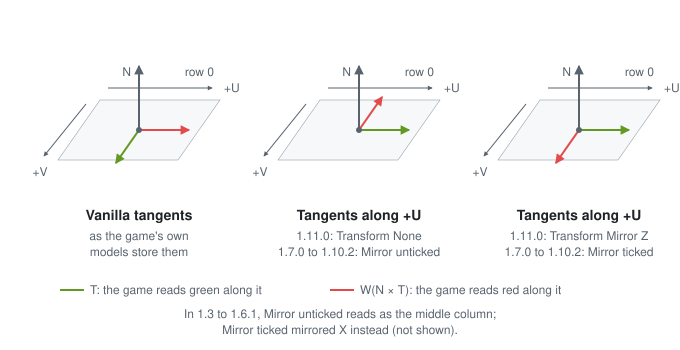
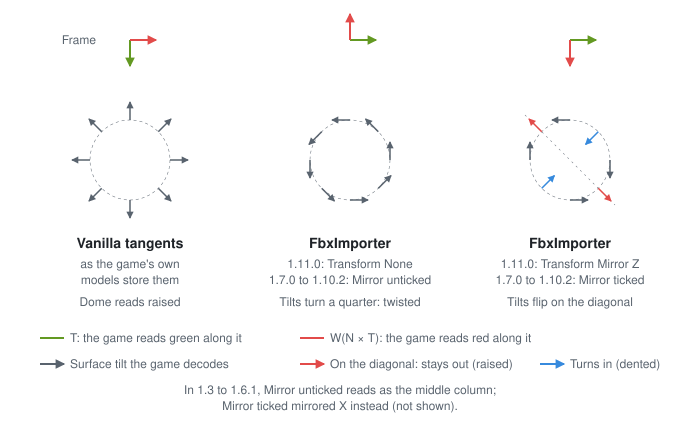

# Normal maps and tangents in Elden Ring

For the full analysis, with the maths, handedness and sources, see the paper
[`paper/ER_NORMAL_MAPS.md`](paper/ER_NORMAL_MAPS.md).

This page records how Elden Ring reads normal maps, and what that means for meshes imported with FbxImporter. It
applies to Elden Ring; Dark Souls 3 and Sekiro were not checked. The figures are generated by
[`figures/make_figures.py`](figures/make_figures.py), and the tests check them against the rules on this page.

## The layout of a normal map

Elden Ring's normal maps (the `_n` textures) use the **DirectX layout**:
- **red** points the surface towards +U;
- **green** points the surface towards +V, where V runs down the image (row 0 is the top);
- a raised detail is encoded as raised;
- **blue** holds gloss, not the normal's third component, and **alpha** holds other data.

*The layout of a normal map. On a raised bump, red is high on its +U side and green on its +V side.*

A normal map baked in the DirectX layout is therefore in the game's layout as it is. In Blender's bake settings that
is the swizzle +X, -Y, +Z; Blender's default (+X, +Y, +Z) is the OpenGL layout, whose green must be inverted.

## The tangent frame on the game's own models

Each vertex of a FLVER mesh stores a tangent `T` with a fourth component `W`:
- `T` points along **+V** of the stored UVs, at right angles to the normal `N`;
- `W` is +1 or -1, chosen so that `W (N × T)` points along **+U**;
- on mirrored UV islands `W` has the opposite sign, so both halves read the same map the same way.

`N × T` is the cross product of the two arrows: a third arrow at right angles to both. FLVER space is left-handed,
so as seen in game the cross product follows the **left-hand rule**: point the thumb along `N` and the index finger
along `T`, and the middle finger, bent at right angles to both, points along `N × T`. On an island whose texture looks
unmirrored in game, `N × T` points along -U, and `W` is -1.

*The tangent frame on an unmirrored and a mirrored island, seen in perspective. The dashed arrow is `N × T` before
`W` is applied.*

The game reads green along `T` and red along `W (N × T)`. A mesh whose tangents follow this frame shows a
DirectX-layout map as intended.

## How this was established

- **The layout:** a slope test on the game's normal maps. For a real height field, the change of the U slope along V
  equals the change of the V slope along U. The pairing "red with U, green with V, same sign" fits best on
  97% of the maps tested (the paper's Section IV-A).
- **The frame:** measured on every vanilla part model. The stored tangent points along +V, and the `W` rule holds,
  mirrored UV islands included, except on meshes with a cloth material, which keep `W` at -1 there. On islands whose
  texture looks unmirrored in game, the stored `W` is -1.
- **In game:** a vanilla body part with a test map whose rows alternate two encodings of the same raised shapes,
  DirectX and DirectX with green flipped. Only the DirectX rows look raised, with their bright side towards the light.
- **FbxImporter's frames:** measured on FbxImporter 1.11.0 imports of a test plane, under Transform None and Transform
  Mirror Z. For releases 1.3 to 1.10.2, read from their source code: they write the tangents the same way.

## Tangents in the common convention

FBX files and the FBX SDK follow the common convention, with tangents along **+U**: a quarter turn from the game's
frame. FbxImporter keeps the tangents of the FBX file, or the ones the FBX SDK generates when the file has none. The
setting that decides what happens next has a different name in different releases:

| FbxImporter 1.11.0 | FbxImporter 1.7.0 to 1.10.2 | FLVER Prep option | The map reads |
|---|---|---|---|
| Transform None | Mirror unticked | Mirror Z on | a quarter turn off |
| Transform Mirror Z | Mirror ticked | Mirror Z off | with red and green swapped |

In FbxImporter 1.3 to 1.6.1, Mirror unticked reads as Transform None; Mirror ticked mirrored X instead, which is not
covered here.

*The directions in which the game reads green and red, for vanilla tangents and for tangents along +U.*

The game rebuilds each pixel's tilt as "red along `W (N × T)` plus green along `T`". So an authored tilt (a, b), its
+U and +V parts, reads as (b, -a) with Transform None (Mirror unticked) and as (b, a) with Transform Mirror Z (Mirror
ticked): every tilt is turned a quarter, or flipped across the U = V diagonal.

*What this does to a raised dome. Worked out from the frames above; not tested in game.*

## Ways out of Blender

| Route | Tangents in the FBX file | What FbxImporter writes |
|---|---|---|
| FLVER Prep's Prepare and Export (it never adds tangents) | none | FBX SDK tangents along +U |
| Blender's FBX export, **Tangent Space** off (the default) | none | FBX SDK tangents along +U |
| Blender's FBX export, **Tangent Space** on | Blender's tangents along +U, with no `W` | those tangents; `W` is undefined, so mirrored UV halves may also be wrong (not tested) |

FbxImporter keeps tangents that the file already has and only generates missing ones.

## The fix: ER Tangents

A fork of FbxImporter, [shintheweapon/FbxImporter, branch `develop`](https://github.com/shintheweapon/FbxImporter/tree/develop),
adds an **ER Tangents** check box to the mesh import options. It starts ticked for Elden Ring FLVERs and unticked for
the other games. It is source only; there is no release build. The same change is offered to FbxImporter itself as
[The12thAvenger/FbxImporter#10](https://github.com/The12thAvenger/FbxImporter/pull/10).

When ticked, the importer ignores the file's tangents and builds them from the mesh after the Transform: for each
vertex it adds up the +V and +U directions of the triangles around it, weighted by area, makes the +V sum
perpendicular to the normal, and takes `W` from the +U side. This works for every Transform setting and every route
above.

It was checked in four ways:
- it reproduces the tangents stored in vanilla parts;
- imports through it follow the game's frame on normal and mirrored UV halves, under Transform None and Mirror Z;
- unticked, it writes exactly what the upstream FbxImporter writes;
- in game, a ticked and an unticked plane side by side with the test map: only the ticked one looks right on both
  halves.

## Without the fix

With FbxImporter 1.7.0 to 1.11.0, change the normal map instead (worked out from the frames above; not tested in game):

| FbxImporter 1.11.0 | FbxImporter 1.7.0 to 1.10.2 | FLVER Prep option | New red | New green |
|---|---|---|---|---|
| Transform None | Mirror unticked | Mirror Z on | 1 minus green | red |
| Transform Mirror Z | Mirror ticked | Mirror Z off | green | red |

Blue and alpha stay as they are.
