# Normal Maps and Tangent Frames in Elden Ring: Measurement, Analysis and Matching Tangents on Import

English | [简体中文](ER_NORMAL_MAPS.zh-CN.md)

**shintheweapon and Claude (Anthropic, Claude Opus 5.5)**

*AI disclosure: see the Acknowledgement.*

**Abstract:** Custom meshes brought into Elden Ring can show their normal maps shaded in the wrong directions. This
paper sets out the convention the game uses and how it was measured: a DirectX-layout map, read with green along the
stored tangent, which points along +V, and red along the bitangent $W(\vec{N}\times\vec{T})$, which points along +U. An
integrability test on the game's normal maps (their red and green must be the derivatives of one height field) fixes the
pairing of channels with UV axes; vanilla models fix the frame; an in-game test fixes the overall sign and confirms
both. Tangents in the common convention, which the FBX
format and the FBX SDK follow, point along +U. Depending on the importer's mirror setting, the game then rotates every
authored tangent-space normal (the normal a map stores, relative to the surface) by 90° anticlockwise on the map (from
+U towards −V), or reflects it about the line $U = V$. The paper derives both effects, describes an import step, ER
Tangents, that builds the tangents in the game's convention from the mesh and its UVs, and derives channel changes that
match the map to the tangents instead. Every formula is stated in words as well.

**Index Terms:** normal mapping, tangent space, handedness, Elden Ring, FLVER, FBX import.

## Notation

- $a$ (no accent): a scalar.
- $\vec{a}$: a vector. $\hat{a}$: a unit vector, a vector of unit length.
- $\vec{a}\cdot\vec{b}$: the dot product, a scalar that is positive when the angle between the vectors is less than 90°
  and zero when they are orthogonal.
- $\vec{a}\times\vec{b}$: the cross product, a vector orthogonal to both (Section II-C).
- A scalar written next to a vector multiplies it (scalar multiplication): $W\vec{a}$ is $\vec{a}$ scaled by $W$,
  reversed when $W = -1$.
- $\propto$: proportional to, that is, equal up to a positive scalar factor.
- $\lVert\vec{a}\rVert$: the length (Euclidean norm) of $\vec{a}$; $\vec{a}/\lVert\vec{a}\rVert$ is $\vec{a}$
  normalised.
- $\partial h/\partial u$: the partial derivative of $h$ with respect to $u$, its rate of change along +U with $v$ held
  fixed; $\partial h/\partial v$ likewise along +V.

## I. Introduction

A normal map stores, for each pixel, a tangent-space normal: the shading normal's direction relative to the surface.
The game transforms it into a shading normal using a tangent frame of three vectors stored on every vertex. When the
frame on a mesh follows a different convention from the one the map was made for, every tangent-space normal is read in
the wrong basis: raised details look dented, or lit from the side.

Meshes made in Blender reach Elden Ring through an importer that converts FBX files to the game's model format, FLVER
[1]. The importer keeps the tangents of the FBX file, or generates them with the FBX SDK [2], in the common convention.
The game's own models use a different one, so the two disagree. The importer can also mirror the model along Z as it
converts it, negating the z components of positions, normals and tangents; this paper calls the two cases "without a
mirror" and "with Z mirrored". This paper:

- measures the convention of the game's own models (Sections III and IV);
- derives what tangents in the common convention do to it (Section V);
- describes an import step, ER Tangents, that builds tangents in the game's convention (Section VI);
- derives how to match the map to the tangents instead (Section VII).

## II. Background

### A. Normal Mapping and the TBN Frame

Blinn introduced shading with a perturbed normal [3]. A real-time normal map stores the perturbed normal in tangent
space: relative to the surface at that point rather than to the world. One map then serves a surface in any position,
and the same UV island (a connected patch of the UV layout) can be reused on several parts. To shade, the renderer needs, at each point, the surface normal
$\vec{N}$ and two vectors in the tangent plane, the tangent $\vec{T}$ and the bitangent $\vec{B}$, which give the
directions of the image's U and V axes on the mesh. The three form the TBN frame $[\vec{T}\ \vec{B}\ \vec{N}]$. They
are built per vertex from the mesh and its UVs, which is why a mesh carries tangents. In the common convention,
$\vec{T}$ follows +U and $\vec{B}$ follows +V, and the shading normal is

$$
\vec{n} \propto x\,\vec{T} + y\,\vec{B} + z\,\vec{N} \tag{1}
$$

*In words:* the tangent-space normal has three components, x, y and z. The shading normal is the linear combination of
the tangent, the bitangent and the surface normal with these weights, normalised.

### B. DirectX and OpenGL Layouts

The two common layouts differ in how the green channel is read. In the DirectX layout V = 0 is at the top row of the
image, so +V runs down the image; in the OpenGL layout V = 0 is at the bottom row, so +V runs up. Both store the image
the same way, so a map converts from one layout to the other by inverting green [4].

### C. Handedness

The cross product of two vectors is computed with the same formula in every coordinate system:

$$
\vec{a}\times\vec{b} = (a_y b_z - a_z b_y,\ a_z b_x - a_x b_z,\ a_x b_y - a_y b_x) \tag{2}
$$

*In words:* each component of the result combines the other two components of the inputs. The result is orthogonal to
both vectors, and its length is the area of the parallelogram they span.

The formula fixes the components; the handedness of the axes fixes which way the result points when drawn. In a
right-handed coordinate system, the right hand gives the direction: thumb along $\vec{a}$, index finger along
$\vec{b}$, and the middle finger, bent perpendicular to both, along $\vec{a}\times\vec{b}$. In a left-handed coordinate
system, the left hand does. Handedness decides two things that matter here:

- the drawn direction of every cross product;
- which side of a triangle is its front face, through the order of its vertices (the winding order).

A reflection, a scaling by $-1$ along one axis, reverses both. An FBX file declares its axis system, which may be
right-handed or left-handed: the FBX SDK's presets for Maya, 3ds Max, MotionBuilder and OpenGL are right-handed, and
those for DirectX and Lightwave are left-handed [2]. The SDK describes its 3ds Max preset as x to the right, z up and y
into the screen. Blender's Front view shows the same: +X to the right, +Z up and +Y into the screen, read from the
view's rotation in Blender 4.5. So Blender's 3D space is right-handed with Z up.

Which way an axis points on screen depends on the view, so this paper names the view each time: the image, with row 0
at the top; Blender's Front view; and a model in game, seen from in front. In a view with x to the right and y up, a
right-handed coordinate system has z pointing out of the screen, towards the viewer, and a left-handed one has z
pointing into the screen.

## III. Elden Ring's Convention

### A. Layout

Elden Ring's normal maps use the DirectX layout (Fig. 1). Red holds the tangent-space normal's x component, towards +U,
and green its y component, towards +V, with +V running down the image. The UVs a FLVER stores run the same way, with
V = 0 at the top row: were V to run up, green read along $\vec{T}$, which follows +V (III-B), would be inverted, and
the DirectX rows of the in-game test (IV-C) would look dented. Blue and alpha hold no part of the normal in
the reading used here: it has long been held in the FromSoftware modding community that blue stores gloss and alpha
other data. This paper did not test what blue or alpha hold. With the red and green values $R$ and $G$ between 0 and
1:

$$
x = 2R - 1, \qquad y = 2G - 1 \tag{3}
$$

*In words:* a channel value of one half means a component of zero; values above it give a positive component, towards
+U (red) or +V (green), and values below it a negative one.

With blue holding no part of the normal, z is not stored and is reconstructed:

$$
z = \sqrt{1 - x^2 - y^2} \tag{4}
$$

*In words:* z is chosen so that the normal has unit length.

Reconstructing $z$ this way is common real-time graphics practice. It is unconfirmed for Elden Ring, because the game's
shaders have not been examined (decompiled) and no in-game test isolates it. For a surface with height $h(u, v)$, the
usual relation between the height and the stored normal is

$$
x = \frac{-\,\partial h/\partial u}{\sqrt{1 + (\partial h/\partial u)^2 + (\partial h/\partial v)^2}}, \qquad
y = \frac{-\,\partial h/\partial v}{\sqrt{1 + (\partial h/\partial u)^2 + (\partial h/\partial v)^2}} \tag{5}
$$

*In words:* where the surface falls away towards +U, red is high, and where it falls away towards +V, green is high. The
square root normalises the vector. So on a raised bump, red is high on its +U side and green on its +V side.

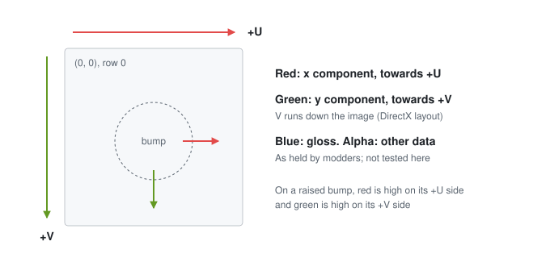

Fig. 1. Layout of a normal map. On a raised bump, red is high on its +U side and green on its +V side.

### B. The Vanilla Tangent Frame

Each vertex of a FLVER mesh stores a tangent $\vec{T}$ and a bitangent sign $W$, either $+1$ or $-1$. On the game's own
(vanilla) models, $\vec{T}$ points along +V of the stored UVs, orthogonal to $\vec{N}$. The bitangent is not stored; it
is

$$
\vec{B} = W\,(\vec{N}\times\vec{T}) \tag{6}
$$

*In words:* the bitangent is the cross product of the normal and the tangent, reversed when W is −1. W is chosen so that
the bitangent points along +U.

The roles are swapped from (1): there $\vec{T}$ follows +U and $\vec{B}$ follows +V, while in the game's convention
$\vec{T}$ follows +V and $\vec{B}$ follows +U. The game reads green along $\vec{T}$ and red along $\vec{B}$:

$$
\vec{n} = \frac{x\,\vec{B} + y\,\vec{T} + z\,\vec{N}}{\lVert x\,\vec{B} + y\,\vec{T} + z\,\vec{N}\rVert} \tag{7}
$$

*In words:* the shading normal is the linear combination of the bitangent (+U), the tangent (+V) and the normal with
weights x, y and z, normalised. Normalisation is common practice, unconfirmed for Elden Ring for the reason given in
Section III-A.

The value of $W$ an island needs follows from the shape of the mesh. Write $\vec{p}(u, v)$ for the point of the surface
at UV position $(u, v)$, and $\vec{a} = \partial\vec{p}/\partial u$ and $\vec{b} = \partial\vec{p}/\partial v$ for the
partial derivatives of position along +U and +V. The normal is
$\vec{N} = s\,(\vec{a}\times\vec{b})/\lVert\vec{a}\times\vec{b}\rVert$ with $s = \pm 1$, and
$\vec{T} = \vec{b}/\lVert\vec{b}\rVert$. The identity

$$
(\vec{a}\times\vec{b})\times\vec{b} = (\vec{a}\cdot\vec{b})\,\vec{b} - (\vec{b}\cdot\vec{b})\,\vec{a} \tag{8}
$$

*In words:* crossing $\vec{a}\times\vec{b}$ with $\vec{b}$ again gives a vector in the tangent plane that points
opposite to $\vec{a}$, apart from a component along $\vec{b}$.

gives $\vec{N}\times\vec{T} \propto -s\,\vec{a}$, apart from a component along $\vec{T}$. For $W(\vec{N}\times\vec{T})$
to point along +U, $W$ must be $-s$:

$$
W = -\operatorname{sign}\!\left(\vec{N}\cdot\left(\frac{\partial\vec{p}}{\partial u}\times\frac{\partial\vec{p}}{\partial v}\right)\right) \tag{9}
$$

*In words:* W is −1 when the dot product of the normal with the cross product of the partial derivatives along +U and +V
is positive, and +1 when it is negative. A mirrored UV island reverses that cross product, and so has the opposite W
(Fig. 2).

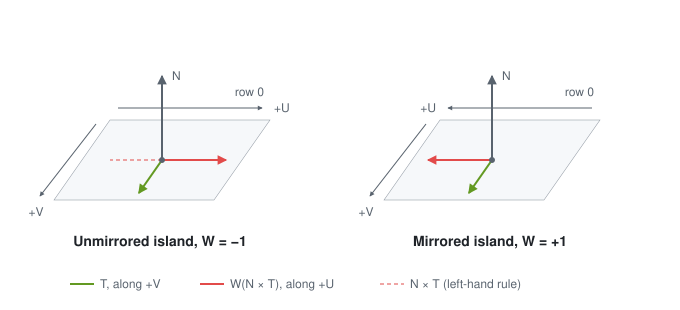

Fig. 2. Tangent frame on an unmirrored and a mirrored island, seen in perspective. The dashed arrow is
$\vec{N}\times\vec{T}$ before $W$ is applied.

### C. The Handedness of FLVER Space

**Question.** Is FLVER space left-handed or right-handed? FLVER files do not say.

**Why it matters.** Handedness decides which way $\vec{N}\times\vec{T}$ points as seen in game, and so which value of
$W$ an island whose texture looks unmirrored needs.

**How the test answers it.** Two properties of one vanilla model, the face part FC_F_0000: its anatomy fixes the
handedness, and its winding agrees with it.

- **Anatomy:** the character stands along +Y, faces −Z, and has its left side at +X. Seen from in front, x points to
  the right, y up and z into the screen. In the FBX SDK's terms that is a left-handed coordinate system, the same as its
  DirectX preset [2].
- **Winding:** computed with (2), $(\vec{p}_1-\vec{p}_0)\times(\vec{p}_2-\vec{p}_0)$ points opposite to the stored
  normal on almost all triangles of LOD0, the most detailed level of detail. With the stored normals pointing outward,
  front faces therefore run clockwise under right-handed maths, which is anticlockwise as seen in a left-handed space.

**Result.** FLVER space is left-handed, so as seen in game $\vec{N}\times\vec{T}$ follows the left-hand rule. On an
island whose texture looks unmirrored in game, $\vec{N}\times\vec{T}$ points along −U, and (6) needs $W = -1$. The
test has limits: one model, LOD0 only, and handedness inferred from anatomy and winding.

**Impact on the implementation.** Equation (9), and the import step of Section VI, ER Tangents, through (19), give
$W = -1$ on unmirrored islands. A Blender scene is carried into this space by swapping its Y and Z axes (Fig. 3(a) and (b)): a −90°
rotation about X, which brings Blender's up (+Z) to +Y and its forward direction (−Y) to +Z, then Z negated, which
brings forward to −Z. The swap is a reflection (determinant −1): it carries Blender's right-handed space into the
left-handed FLVER space, and the character keeps its left side at +X.

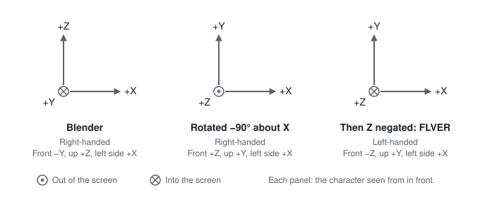

Fig. 3. Axis swap from Blender into FLVER space. (a) Animated: a character's coordinates through the rotation about X
and the negation of Z, in fixed axes drawn as Blender's Front view shows them. (b) Each stage seen from in front of the
character, whose left side is to the right; a circle with a dot points out of the screen, a circle with a cross into
it.

## IV. Measurements

### A. The Integrability Test

**Question.** Are the game's normal maps stored in the DirectX layout: red with U, green with V, and green not
inverted?

**Why it matters.** The layout decides which channel holds which component of the tangent-space normal, and so which
channel the game must read along which vector of the frame. A wrong layout swaps red and green, or inverts green.

**How the test answers it.** A map stores the derivatives of one height field, and the mixed partial derivatives of a
height field are equal. Only the right pairing of channels with UV axes, with the right relative sign, satisfies that,
so each map shows its own layout, without running the game.

For any smooth height field, the mixed partial derivatives are equal (Schwarz's theorem):

$$
\frac{\partial}{\partial v}\!\left(\frac{\partial h}{\partial u}\right) = \frac{\partial}{\partial u}\!\left(\frac{\partial h}{\partial v}\right) \tag{10}
$$

*In words:* the rate of change of $\partial h/\partial u$ along V equals the rate of change of $\partial h/\partial v$
along U.

For small derivatives, (3) and (5) give $x \approx -\partial h/\partial u$ and $y \approx -\partial h/\partial v$, so a
map in the assumed layout must satisfy

$$
\frac{\partial R}{\partial v} \approx \frac{\partial G}{\partial u} \tag{11}
$$

*In words:* the partial derivative of red along V (down the image) matches that of green along U (across it).

The two sides were computed by central differences and compared by their Pearson correlation over the more detailed
half of a map's pixels: those where the sum of the absolute values of the four partial derivatives of red and green is
above its median. The other pairing, red with V and green with U (the swapped pairing), compares $\partial R/\partial u$
with $\partial G/\partial v$ in the same way. The pairing whose correlation is larger in absolute value wins, and the
sign of that correlation tells whether green is inverted relative to red. A map's outcome comes from the whole map.
Tiles of 256 by 256 pixels serve only to tell whether a map has detail to test: a tile is skipped when the standard
deviation of both channels is below 0.03, with channel values from 0 to 1. A map is untestable when a channel does not
vary at all or every tile is skipped.

The test ran on 1,437 normal maps, one per file name, from the game's part files as installed for this paper; 50 of them
are untestable. The test's script and its per-map results are published with this paper [5]; reproducing them needs the
game's own files, which are not distributed. Per file-name prefix, over the testable maps (Table I):

TABLE I LAYOUT TEST ON THE GAME'S PART NORMAL MAPS, PER FILE-NAME PREFIX

| Prefix | Testable maps | Untestable | DirectX pairing, positive sign | Median correlation, DirectX | Median correlation, swapped |
|---|---|---|---|---|---|
| WP (weapons) | 535 | 2 | 98.3% | 0.54 | 0.23 |
| BD (body) | 247 | 2 | 96.8% | 0.54 | 0.24 |
| HD (head) | 226 | 0 | 96.0% | 0.55 | 0.26 |
| LG (legs) | 151 | 0 | 98.7% | 0.50 | 0.21 |
| AM (arms) | 124 | 0 | 97.6% | 0.51 | 0.21 |
| FG | 47 | 39 | 85.1% | 0.46 | 0.27 |
| AA | 36 | 7 | 94.4% | 0.56 | 0.33 |
| FC | 17 | 0 | 100.0% | 0.48 | 0.26 |
| HR | 3 | 0 | 100.0% | 0.43 | 0.21 |
| HA | 1 | 0 | 100.0% | 0.39 | 0.20 |

**Result.** On 1,347 of the 1,387 testable maps (97%), the pairing "red with U, green with V, same sign",
with V running down, wins with a positive correlation (Fig. 4). That pairing is the DirectX layout. The correlation is
moderate, not strong: its median is 0.53, against 0.24 for the swapped pairing. On the other 40
maps the test picks green inverted (32 maps) or the swapped pairing (8 maps). A sample of four of them, viewed shaded with the light from
the top, looked raised when read in the DirectX layout, so the test likely misreads those maps; the others were not
investigated. The test has two limits:

- a map with both red and green inverted gives the same correlations, so the test fixes the pairing and the sign of
  green relative to red, and the in-game test (IV-C) fixes the overall sign;
- it tests how the maps were authored, not how the game reads them.

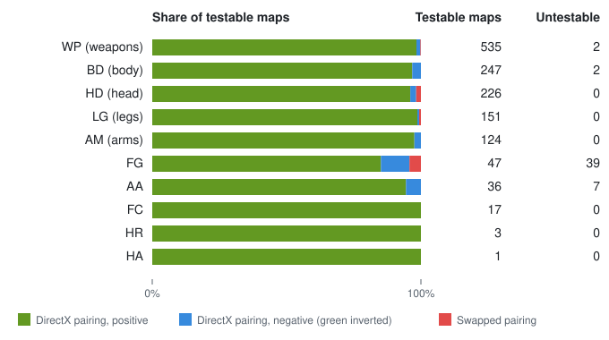

Fig. 4. Layout test on the game's part normal maps: per file-name prefix, the share of testable maps with each
outcome: the DirectX pairing with a positive or a negative correlation, or the swapped pairing.

**Impact on the implementation.** The DirectX layout is what (3) decodes and what the channel changes (20) and (21)
start from. The test corroborates the in-game test (IV-C) across the game's maps; it does not settle the layout alone.

### B. Vanilla Frames

**Question.** What tangent frame do the game's own models store: does $\vec{T}$ follow +V, and is $W$ given by (9)?

**Why it matters.** The game reads every map through the stored frame, so an importer must write the frame the game's
models carry.

**How the test answers it.** The frame a mesh implies follows from its positions and UVs alone, by (15) and (16) of
Section VI.
Comparing it with the stored frame at every triangle corner shows which rule the stored frame follows.

1,515 part models were checked: all those with triangles, tangents and UVs among the game's part files as installed for
this paper. Each was read with SoulsFormatsNEXT [1], the community continuation of TKGP's SoulsFormats: for every mesh,
each vertex's position, normal, first tangent $(\vec{T}, W)$ and first UV, and the triangles of the LOD0 face set. The
check then runs per triangle:

- Equations (15) and (16) give $\partial\vec{p}/\partial u$ and $\partial\vec{p}/\partial v$; degenerate triangles and
  those with no area in UV space are skipped;
- at each of the triangle's three vertices, the stored frame is compared with them:
    - the value of $W$;
    - the length of $\vec{T}$;
    - $|\hat{T}\cdot\hat{N}|$, which is 0 when the tangent is orthogonal to the normal;
    - the cosine between $\vec{T}$ and $\partial\vec{p}/\partial v$ with its component along $\vec{N}$ removed, which is
      1 when the tangent lies along +V;
    - whether $W$ equals (9).

The check, its survey of every mesh and the per-mesh results are published with this paper [5], and the check is tested
with the paper's other formulas. The UV orientation of a triangle is the sign of $d$, the determinant of its UV
differences, (15) in Section VI. For any triangle with edges $\vec{e}_1$ and $\vec{e}_2$,
$\vec{e}_1\times\vec{e}_2 = d\,(\partial\vec{p}/\partial u\times\partial\vec{p}/\partial v)$ by (14) and (15), so the
sign of $d$ tells mirrored from unmirrored only together with the winding. With the game's winding (III-C),
$\vec{N}\cdot(\vec{e}_1\times\vec{e}_2) < 0$, so $\vec{N}\cdot(\partial\vec{p}/\partial u\times\partial\vec{p}/\partial v)$
has the opposite sign to $d$. An unmirrored island, with $W = -1$ by (9), has that dot product positive. So
$d > 0$ on mirrored islands and $d < 0$ on unmirrored ones. Per file-name prefix, with (9) per UV orientation and pooled over all corners; the other columns give the range, the largest value and the smallest value over the prefix's parts (Table II):

TABLE II STORED TANGENT FRAMES OF THE GAME'S PART MODELS, PER FILE-NAME PREFIX

| Prefix | Parts | Triangle vertices checked | Length of $\vec{T}$ | $\lvert\hat{T}\cdot\hat{N}\rvert$, largest 99th percentile | Smallest median cosine with +V | (9) holds, $d > 0$ | (9) holds, $d < 0$ |
|---|---|---|---|---|---|---|---|
| WP (weapons) | 575 | 7,303,518 | 0.987 to 1.014 | 0.032 | 0.961 | 99.45% | 99.75% |
| BD (body) | 334 | 21,370,163 | 0.986 to 1.013 | 0.016 | 0.965 | 92.08% | 99.77% |
| HD (head) | 217 | 7,071,393 | 0.987 to 1.014 | 0.024 | 0.943 | 91.06% | 99.67% |
| LG (legs) | 155 | 6,719,632 | 0.987 to 1.013 | 0.024 | 0.974 | 98.61% | 99.70% |
| AM (arms) | 127 | 2,640,579 | 0.987 to 1.013 | 0.016 | 0.970 | 99.78% | 99.85% |
| FG | 56 | 443,421 | 0.987 to 1.013 | 0.024 | 0.974 | 99.62% | 99.75% |
| HR | 36 | 5,812,887 | 0.987 to 1.014 | 0.016 | 0.921 | 99.40% | 99.61% |
| FC | 15 | 1,106,208 | 0.987 to 1.013 | 0.016 | 0.994 | 99.83% | 99.84% |

**Result.** On all 1,515 parts, $W$ is exactly $+1$ or $-1$, and $\vec{T}$ has unit length to within the stored
precision (0.986 to 1.014). $\vec{T}$ is orthogonal to $\vec{N}$ to within about 2° on 99% of the corners of every
part, and it follows the in-plane +V
direction: the median cosine is at least 0.99 on 76% of parts, and at least 0.95 on all but 2 (the lowest, 0.92, on
HR_A_0115). Both UV orientations occur on 1,422 parts.

Equation (9) holds on both UV orientations, except on one kind of mesh: those whose material name contains "cloth"
(Table III).

TABLE III WHERE (9) HOLDS: CLOTH AND OTHER MESHES

| Meshes | Meshes checked | Parts | (9) holds, $d > 0$ | (9) holds, $d < 0$ |
|---|---|---|---|---|
| Material name contains "cloth" | 1,612 | 490 | 1.39% | 99.73% |
| All other | 8,033 | 1,515 | 99.65% | 99.73% |

On the 17 cloth meshes of four parts that were looked at, $W$ is $-1$ on every vertex, whatever the UV orientation,
while $\vec{T}$ still follows +V, so (9) fails on their mirrored islands. In the modding community these materials are
known to mark meshes moved by cloth simulation rather than by bones; why they keep $W = -1$ was not investigated, and
whether the game uses $W$ on them was not tested. Outside cloth materials, 43 meshes fail (9) on more than 5% of their
corners; they were not investigated. On the weapon WP_A_1253, whose UVs are mostly unmirrored, most vertices carry
$W = -1$, the value (9) gives on unmirrored islands.

An importer sees the material file each mesh uses (the game's matxml file, which the mesh's material names) rather than
its material name. On the
meshes with corners where $d > 0$, a mesh keeps $W = -1$ when (9) fails on at least 95% of those corners, follows (9)
when it holds on at least 95%, and is mixed otherwise; it agrees when its material file contains "cloth" and it keeps
$W = -1$, or its file does not and it follows (9) (Table IV):

TABLE IV HOW MESHES STORE W ON MIRRORED CORNERS, BY MATERIAL FILE

| Material file | Meshes | Keep $W = -1$ | Follow (9) | Mixed | Agree, by meshes | Agree, by corners |
|---|---|---|---|---|---|---|
| Contains "cloth" | 854 | 820 | 3 | 31 | 96.0% | 98.1% |
| All other | 6,345 | 45 | 6,116 | 184 | 96.4% | 99.5% |

The material file and the material name disagree on containing "cloth" on 22 meshes; on 21 of them the material file
predicts the frame. The 263 meshes that do not agree hold 97,170 of the 16,729,648 corners where $d > 0$. 192 of them
have fewer than 30 such corners. The 22 mixed meshes without a cloth material file that have 300 or more corners where
$d > 0$ follow (9) on at least 83% of them. On their corners where $d < 0$ they follow it on nearly the same share (a
difference of 2 points at the median and 12 at most), so they look imprecise rather than like cloth. One large mesh with a cloth material file, on FC_M_0105,
follows (9) on all 4,806 of its corners where $d > 0$. The rule was not investigated further.

These measurements fix the stored frame outside cloth meshes: $\vec{T}$ along +V, and $W$ such that
$W(\vec{N}\times\vec{T})$ points along +U. Which channel the game reads along which direction follows from two other
results. The integrability test (IV-A) pairs red with U and green with V, and the in-game test (IV-C) fixes the
overall sign through the stored frame. So green is read along $\vec{T}$ and red along $W(\vec{N}\times\vec{T})$, which is (7).

**Impact on the implementation.** ER Tangents builds $\vec{T}$ along +V and $W$ by (19), which gives the same
value as (9) wherever the triangles around a vertex agree. On the mirrored islands of cloth meshes, ER Tangents writes $W = +1$ where the game's own models keep $-1$; the
effect in game was not tested. An optional import step could set $W = -1$ on every tangent of a mesh with a cloth
material, matching almost all of the game's cloth meshes. Because the name rule has exceptions, the step would be chosen
for each import rather than applied by the material name, and it is not tested in game.

### C. The In-Game Test

**Question.** Does the game read the maps as IV-A and IV-B imply: the DirectX layout, with green along $\vec{T}$ and
red along $W(\vec{N}\times\vec{T})$, so that raised shapes look raised?

**Why it matters.** IV-A and IV-B measure files; only the game shows how it reads them. IV-A also leaves the overall
sign open.

**How the test answers it.** The same raised shapes in two encodings, side by side under one light: only the encoding
the game reads as intended looks raised.

A vanilla body part, BD_M_1730, was given a test map whose rows alternate two encodings of the same raised shapes:
DirectX, and DirectX with green inverted. The part's albedo tints the rows, warm on the DirectX rows and cool on the
green-inverted ones.

**Result.** In game (Fig. 5), with the light from above, only the DirectX rows look raised, with their bright side
towards the light; the green-inverted rows look dented. The two encodings differ only in green, so this fixes the
overall sign of green read along $\vec{T}$; with the pairing from IV-A, it confirms the layout and the frame.

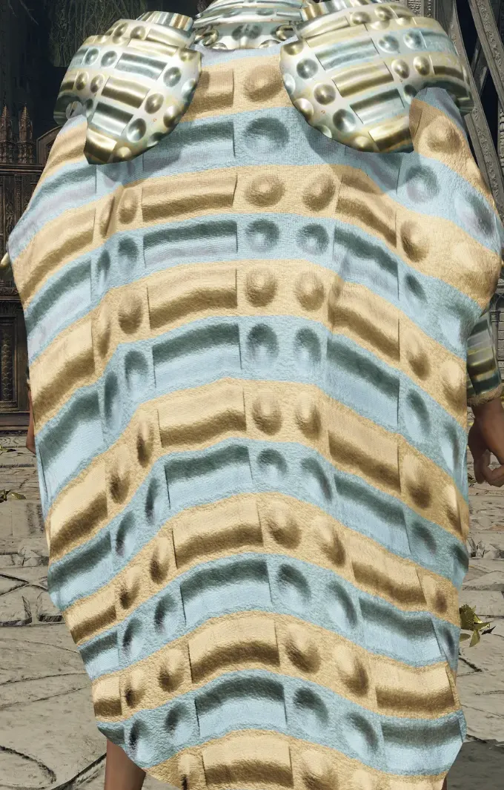

Fig. 5. In-game test on BD_M_1730. Warm rows: the DirectX encoding, raised. Cool rows: green inverted, dented.

**Impact on the implementation.** It confirms (7), on which ER Tangents and the channel changes of Section VII rely.

### D. Import Measurements

**Question.** What frame does the importer write without ER Tangents?

**Why it matters.** Its difference from the vanilla frame (IV-B) is the error the paper sets out to remove.

**How the test answers it.** A test plane with one unmirrored and one mirrored UV half was imported twice, once without
a mirror and once with Z mirrored, and the frames stored in each import were read back. The plane's file carries no
tangents, so the importer generates them with the FBX SDK.

**Result.** In both imports the tangent points along +U on both halves, and $W$ is $-1$ on one half and $+1$ on the
other.

- Without a mirror, $W = -1$ on the unmirrored half, and red is read along −V on both halves.
- With Z mirrored, $W = +1$ on the unmirrored half, and red is read along +V on both halves.

Each half is named by its state after the import.

So in each import both halves are read alike. The test has limits: one test plane, with tangents generated rather than
carried by the file.

**Impact on the implementation.** These frames give (12) and (13): the rotation and the reflection that ER Tangents
removes, and that the channel changes of Section VII undo instead. Both hold on mirrored islands as well as unmirrored
ones.

## V. Tangents in the Common Convention

The tangents the FBX SDK generates for a file without them [2] point along +U, as measured in Section IV-D. Tangents
an FBX file carries follow the common convention, such as Blender's (Section VI), and were not measured here. The
importer keeps them as they are. Write $\hat{u}$ and $\hat{v}$ for the unit vectors along
+U and +V in the tangent plane, and $\vec{T}'$, $W'$ and $\vec{B}'$ for the tangent, the bitangent sign and the
bitangent of the frame the importer writes. With the frames measured in IV-D, they are

$$
\vec{T}' = \hat{u}, \qquad
\vec{B}' = W'\,(\vec{N}\times\hat{u}) = \begin{cases} -\hat{v} & \text{without a mirror} \\ +\hat{v} & \text{with Z mirrored} \end{cases} \tag{12}
$$

*In words:* with tangents along +U, green is read along +U, and red along −V (without a mirror) or +V (with Z mirrored) (Fig. 6).

The mirror turns red from −V to +V. Negating z reflects the normal, the tangent and the partial derivatives alike, and
a reflection reverses every cross product, so $\vec{N}\times\hat{u}$ reverses relative to +V, which is reflected with
it. The reflection also swaps every island between mirrored and unmirrored, while each vertex keeps the $W'$ generated
before the mirror. That is what IV-D finds: the half with $W = -1$ is the unmirrored one without a mirror, and the
mirrored one with Z mirrored.

An authored tangent-space normal with (x, y) components $(a, b)$, $a$ towards +U and $b$ towards +V, is meant as the
direction $a\,\hat{u} + b\,\hat{v}$ in the tangent plane. By (7) the game reads it as $a\,\vec{B}' + b\,\vec{T}'$, which
in $(U, V)$ components is

$$
\begin{pmatrix} b \\ -a \end{pmatrix} = \begin{pmatrix} 0 & 1 \\ -1 & 0 \end{pmatrix}\begin{pmatrix} a \\ b \end{pmatrix} \ \text{(without a mirror)}, \qquad
\begin{pmatrix} b \\ a \end{pmatrix} = \begin{pmatrix} 0 & 1 \\ 1 & 0 \end{pmatrix}\begin{pmatrix} a \\ b \end{pmatrix} \ \text{(with Z mirrored)} \tag{13}
$$

*In words:* without a mirror, the (x, y) components of every tangent-space normal are rotated by 90° anticlockwise on
the map (from +U towards −V); with Z mirrored, they are reflected about the line U = V. A raised dome then reads lit
from the side, or raised on the U = V diagonal, dented on the U = −V diagonal and lit from the side along U and V
(Fig. 7).

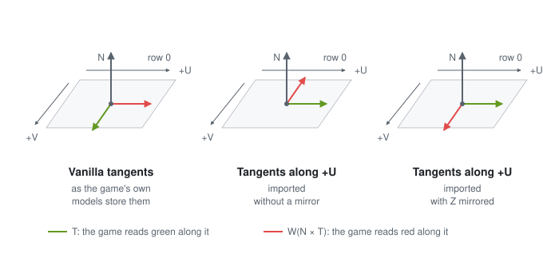

Fig. 6. Directions in which the game reads green and red, for vanilla tangents and for tangents along +U.

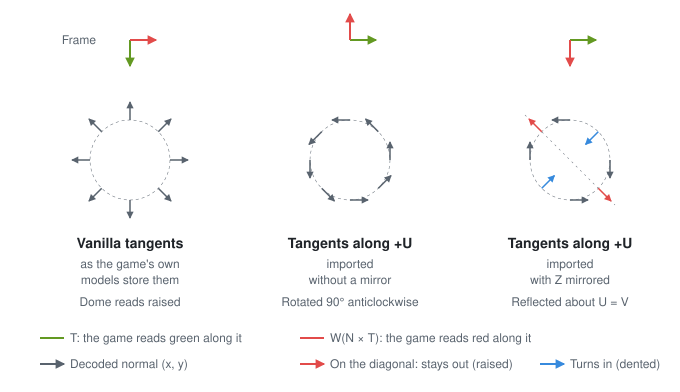

Fig. 7. Animated: the decoded tangent-space normals around a raised dome in each case.

## VI. ER Tangents

ER Tangents is an import step [6] that builds tangents in the game's convention. With it, the importer builds the
tangents from the mesh after the importer's axis change, in place of the file's. It is adapted from Lengyel's method
[7], which computes per-triangle tangents, averages them per vertex, orthogonalises them against the normal
(Gram-Schmidt) and stores the handedness as ±1. Here the tangent follows +V instead of +U, and each triangle
contributes normalised directions weighted by its area. The steps run as follows.

**Per triangle.** Degenerate triangles, with a repeated vertex, are skipped. For vertices
$\vec{p}_0, \vec{p}_1, \vec{p}_2$ with UVs $(u_i, v_i)$, the edges are $\vec{e}_1 = \vec{p}_1 - \vec{p}_0$ and
$\vec{e}_2 = \vec{p}_2 - \vec{p}_0$, with UV differences $\Delta u_1 = u_1 - u_0$, $\Delta v_1 = v_1 - v_0$, and
likewise $\Delta u_2$, $\Delta v_2$. Across a flat triangle, position varies linearly with UV:

$$
\vec{e}_1 = \Delta u_1\,\frac{\partial\vec{p}}{\partial u} + \Delta v_1\,\frac{\partial\vec{p}}{\partial v}, \qquad
\vec{e}_2 = \Delta u_2\,\frac{\partial\vec{p}}{\partial u} + \Delta v_2\,\frac{\partial\vec{p}}{\partial v} \tag{14}
$$

*In words:* each edge is a linear combination of the partial derivatives along +U and +V, weighted by its UV
differences.

$$
d = \Delta u_1\,\Delta v_2 - \Delta u_2\,\Delta v_1 \tag{15}
$$

*In words:* d is the determinant of the UV differences: twice the signed area of the triangle in UV space. When d is
zero, or nearly, the triangle has no area in UV space and is skipped.

$$
\frac{\partial\vec{p}}{\partial u} = \frac{\Delta v_2\,\vec{e}_1 - \Delta v_1\,\vec{e}_2}{d}, \qquad
\frac{\partial\vec{p}}{\partial v} = \frac{\Delta u_1\,\vec{e}_2 - \Delta u_2\,\vec{e}_1}{d} \tag{16}
$$

*In words:* solving (14) for the two partial derivatives gives the directions in which U and V increase on this
triangle.

**Per vertex.** Each triangle adds both partial derivatives, normalised and then weighted by
$\lVert\vec{e}_1\times\vec{e}_2\rVert$ (twice its area), to each of its three vertices:

$$
\vec{s}_u = \sum \lVert\vec{e}_1\times\vec{e}_2\rVert\,\frac{\partial\vec{p}/\partial u}{\lVert\partial\vec{p}/\partial u\rVert}, \qquad
\vec{s}_v = \sum \lVert\vec{e}_1\times\vec{e}_2\rVert\,\frac{\partial\vec{p}/\partial v}{\lVert\partial\vec{p}/\partial v\rVert} \tag{17}
$$

*In words:* each vertex accumulates, over the triangles around it, an area-weighted sum of the +U directions,
$\vec{s}_u$, and one of the +V directions, $\vec{s}_v$; larger triangles count for more.

$$
\vec{T} = \frac{\vec{s}_v - \vec{N}\,(\vec{N}\cdot\vec{s}_v)}{\lVert\vec{s}_v - \vec{N}\,(\vec{N}\cdot\vec{s}_v)\rVert} \tag{18}
$$

*In words:* the accumulated +V direction, with its component along the normal removed (Gram-Schmidt) and normalised, is
the tangent.

$$
W = \begin{cases} +1 & \text{if } (\vec{N}\times\vec{T})\cdot\vec{s}_u \ge 0 \\ -1 & \text{otherwise} \end{cases} \tag{19}
$$

*In words:* W is +1 when the dot product of $\vec{N}\times\vec{T}$ with the accumulated +U direction is zero or
positive, and −1 when it is negative, so that $W(\vec{N}\times\vec{T})$ always points along +U.

**Fallback.** A vertex with no usable normal, an accumulated +V direction of nearly zero length, or one nearly parallel
to its normal keeps the tangent the file or the FBX SDK gave it, with W set to −1 where that tangent's fourth component
is negative and +1 otherwise.

**Winding.** Swapping vertices 1 and 2 swaps the edges and the UV differences, which reverses the sign of $d$ and of
both numerators in (16). The directions and $\lVert\vec{e}_1\times\vec{e}_2\rVert$ stay the same, so the result is the
same for either winding order.

**Worked example.** One triangle: $\vec{p}_0 = (0, 0, 0)$, $\vec{p}_1 = (2, 0, 0)$, $\vec{p}_2 = (0, 0, 1)$; UVs
$(0, 0)$, $(0.5, 0)$, $(0, 0.25)$; normal $\vec{N} = (0, -1, 0)$ at every vertex (Table V, Fig. 8). The triangle
winds the other way from the game's (III-C): $\vec{e}_1\times\vec{e}_2$ points along $\vec{N}$. So $d > 0$ here on an
unmirrored island; (9) and (19) give the same $W$ for either winding.

TABLE V WORKED EXAMPLE FOR ONE TRIANGLE

| Quantity | Value |
|---|---|
| $\vec{e}_1$, $\vec{e}_2$ | $(2, 0, 0)$, $(0, 0, 1)$ |
| $d$ by (15) | $0.125$ |
| $\partial\vec{p}/\partial u$ by (16) | $(4, 0, 0)$ |
| $\partial\vec{p}/\partial v$ by (16) | $(0, 0, 4)$ |
| $\vec{T}$ by (18) | $(0, 0, 1)$ |
| $\vec{N}\times\vec{T}$ by (2) | $(-1, 0, 0)$ |
| $W$ by (19), and by (9) | $-1$ |
| $\vec{B}$ by (6) | $(1, 0, 0)$, along +U |

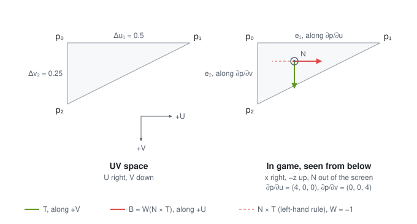

Fig. 8. Worked example's triangle in UV space and in game, seen from below with $\vec{N}$ out of the screen. The
tangent follows +V, and $W = -1$ turns $\vec{N}\times\vec{T}$ onto +U.

**Validation.** ER Tangents was checked as follows.

**Question.** Does an import with ER Tangents carry the game's frame?

**Why it matters.** ER Tangents is the fix this paper proposes; until it is checked, it is only derived.

**How the test answers it.** Four checks [6], from the files to the game:

- on vanilla parts, the recomputed tangents point almost the same way as the stored ones;
- imports with ER Tangents follow the game's frame on both UV halves, without a mirror and with Z mirrored;
- without ER Tangents, the importer writes exactly what the upstream release writes;
- in game, a plane imported with ER Tangents and one imported without, side by side with the test map (Fig. 9): only
  the one with ER Tangents looks alike on both halves.

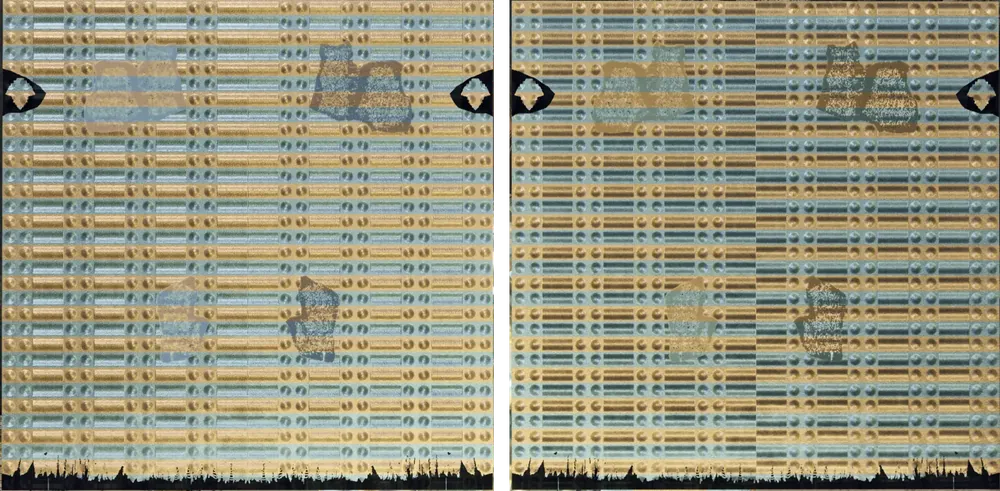

Fig. 9. In-game check of ER Tangents. Left: with ER Tangents, both UV halves look alike. Right: without ER Tangents, the halves disagree.

**Result.** All four agree. In the files, imports with ER Tangents carry the vanilla frame on both UV halves, without a
mirror and with Z mirrored, and imports without it are what the importer wrote before. In game, the plane with ER
Tangents looks alike on both halves; which mirror setting its import used was not recorded. Without ER Tangents, both
halves are read with the same rotation or reflection on the map (IV-D), but the mirrored half shows the map mirrored, so
the two halves look different. That explanation is derived from (13), not tested on its own.

**Impact on the implementation.** The import step can be used with either mirror setting, and imports without it are
unchanged.

**Relation to MikkTSpace.** MikkTSpace [8], [9] is the tangent method Blender uses: its `Mesh.calc_tangents` runs it
[9], and Blender's FBX exporter calls `calc_tangents` when Tangent Space is on. These tangents follow +U and the
exporter writes no W, so they follow the common convention, like the FBX SDK's. ER Tangents builds its own tangents
from the mesh and ignores the file's, so both routes out of Blender give the same frames, apart from fallback vertices,
which keep the file's tangent.

## VII. Matching the Map Instead of the Tangents

Without ER Tangents, the map can be changed so that (13) reads it as authored. Without a mirror a stored tangent-space
normal with components $(a', b')$ is read as $(b', -a')$, so storing $a' = -b$, $b' = a$ gives back $(a, b)$. With
(3):

$$
R' = 1 - G, \qquad G' = R \tag{20}
$$

*In words:* without a mirror, the new red is one minus the old green, and the new green is the old red. On 8-bit
channels, one minus green is 255 minus green.

$$
R' = G, \qquad G' = R \tag{21}
$$

*In words:* with Z mirrored, red and green swap.

Blue and alpha stay as they are. Both changes are worked out from the measured frames, not tested in game
(Fig. 10). Where the FBX SDK generates the tangents, as in IV-D, they apply to mirrored islands too, since in each
import both UV halves are read alike. With Tangent Space on, W is undefined (Section VIII), and mirrored islands are
not covered. Table VI lists both.

TABLE VI CHANNEL CHANGES THAT MATCH THE MAP TO TANGENTS ALONG +U

| Import | New red | New green |
|---|---|---|
| Without a mirror | 1 − green | red |
| With Z mirrored | green | red |

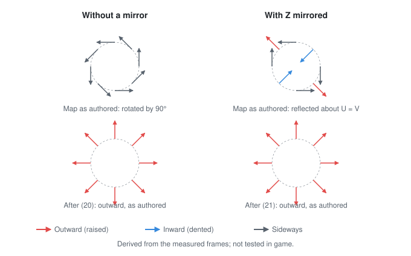

Fig. 10. Decoded tangent-space normals around a raised dome through tangents along +U, from the map as authored
and after (20) or (21). Derived, not tested in game.

## VIII. Practical Use

There are two ways out of Blender (Fig. 11): its FBX export with Tangent Space off, which writes no tangents, and with
Tangent Space on, which writes tangents along +U with no W. Without ER Tangents, both give tangents along +U, since the
importer generates them when the file has none. With it, both give a FLVER in the game's convention. With Tangent Space
on and without ER Tangents, W is undefined, so mirrored UV halves may also read wrong; this has not been tested.

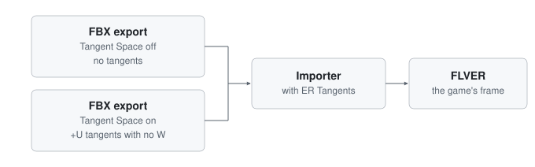

Fig. 11. Ways out of Blender, and the tangents each one gives.

## IX. Limitations

- Reconstructing z (4), normalising (7) and the height relation (5) are common real-time graphics practice. They are
  unconfirmed for Elden Ring, because its shaders have not been examined and no in-game test isolates them.
- What blue and alpha hold was not tested; this paper follows the modding community's view that blue holds gloss.
- The handedness of FLVER space was inferred from one model, LOD0 only.
- Cloth meshes keep $W = -1$ on mirrored islands, unlike (9) and ER Tangents; the cause and the effect in game were not
  tested.
- The layout test ran on the game's part normal maps only. Its correlation is moderate, and of the 40 maps on which
  it disagrees, four were viewed.
- The game version of the files measured in Section IV was not recorded.
- Mirrored and unmirrored halves without ER Tangents were read back from one test plane.
- Only Elden Ring was checked; Dark Souls 3, Sekiro, Armored Core 6 and Nightreign were not.

## X. Conclusion

Elden Ring reads a DirectX-layout map with green along a tangent that follows +V, and red along
$W(\vec{N}\times\vec{T})$, which follows +U. Tangents in the common convention follow +U, so the (x, y) components of
every tangent-space normal are rotated by 90° anticlockwise on the map (from +U towards −V) or reflected about the line
U = V, depending on the mirror setting. Building the tangents from the mesh and its UVs in the game's convention gives
the game's frame for both routes out of Blender, and the intended shading on the plane checked in game. Where that step
is not available, swapping or inverting channels
matches the map to the tangents instead.

## Acknowledgement

This paper was written with Claude Opus 5.5 by Anthropic. Claude drafted the text and equations and generated the
figures. Claude wrote the code and the analysis: the measurement scripts, ER Tangents, the figure generator and its
tests. shintheweapon carried out the in-game tests and the test imports, and made the visual judgements.

## References

[1] soulsmods, "SoulsFormatsNEXT," GitHub repository. [Online]. Available: https://github.com/soulsmods/SoulsFormatsNEXT.
Accessed: 11 Nov. 2026.

[2] Autodesk, *FBX SDK 2020.2.1*, header files `fbxsdk/scene/fbxaxissystem.h` (`FbxAxisSystem`) and
`fbxsdk/scene/geometry/fbxmesh.h` (`FbxMesh::GenerateTangentsDataForAllUVSets`). [Online]. Available:
https://help.autodesk.com/view/FBX/2020/ENU/. Accessed: 11 Nov. 2026.

[3] J. F. Blinn, "Simulation of wrinkled surfaces," *ACM SIGGRAPH Comput. Graph.*, vol. 12, no. 3, pp. 286-292,
Aug. 1978, doi: 10.1145/965139.507101.

[4] Adobe, "What is the difference between the OpenGL and DirectX normal format?," Substance 3D Bakers documentation,
1 May 2026. [Online]. Available:
https://experienceleague.adobe.com/en/docs/substance-3d/bakers/common-questions/what-is-the-difference-between-the-opengl-and-directx-normal-format.
Accessed: 11 Nov. 2026.

[5] shintheweapon, "blender_flver_prep," GitHub repository, branch develop: `docs/figures/` (the scripts
and results of Sections IV-A and IV-B) and `docs/paper/README.md` (how to reproduce them). [Online].
Available: https://github.com/shintheweapon/blender_flver_prep/tree/develop. Accessed: 12 Nov. 2026.

[6] shintheweapon, "FbxImporter," fork, branch develop; and "Add an ER Tangents import option," pull request #10.
[Online]. Available: https://github.com/shintheweapon/FbxImporter/tree/develop and
https://github.com/The12thAvenger/FbxImporter/pull/10. Accessed: 11 Nov. 2026.

[7] E. Lengyel, "Computing tangent space basis vectors for an arbitrary mesh," Terathon Software, 15 Mar. 2004.
[Online]. Available: https://terathon.com/code/tangent.php. Accessed: 11 Nov. 2026.

[8] M. Mikkelsen, "Simulation of wrinkled surfaces revisited," M.S. thesis, Dept. Comput. Sci. (DIKU), Univ.
Copenhagen, Copenhagen, Denmark, Mar. 2008. [Online]. Available:
http://image.diku.dk/projects/media/morten.mikkelsen.08.pdf. Accessed: 11 Nov. 2026.

[9] M. S. Mikkelsen, "MikkTSpace," GitHub repository, 2011. [Online]. Available: https://github.com/mmikk/MikkTSpace.
Blender's port: `intern/mikktspace` and `source/blender/blenkernel/intern/mesh_tangent.cc`, Blender 4.5, [Online].
Available: https://github.com/blender/blender. Accessed: 11 Nov. 2026.
