# 艾尔登法环中的法线贴图与切线坐标系：测量、分析与导入时的切线匹配

[English](ER_NORMAL_MAPS.md) | 简体中文

**shintheweapon 与 Claude（Anthropic，Claude Opus 5.5）**

*AI 使用说明：见致谢。*

**摘要：** 导入艾尔登法环（Elden Ring）的自制网格，其法线贴图可能按错误的方向着色。本文阐明游戏采用的约定及其测量方法：贴图采用 DirectX 布局，绿色沿存储的切线读取，切线指向 +V；红色沿副切线 $W(\vec{N}\times\vec{T})$ 读取，副切线指向 +U。对游戏法线贴图所做的可积性检验（其红色与绿色必须是同一高度场的导数）确定了通道与 UV 轴的配对；原版模型确定了切线坐标系；一项游戏内测试确定了整体符号并确认了二者。通用约定下的切线（FBX 格式和 FBX SDK 均遵循此约定）指向 +U。视导入器的镜像设置而定，游戏会将制作时的每个切线空间法线（贴图存储的、相对于表面的法线）在贴图上逆时针旋转 90°（从 +U 转向 −V），或关于直线 $U = V$ 反射。本文推导了这两种效应；介绍了导入步骤 ER Tangents，它依据网格及其 UV 按游戏的约定构建切线；还推导了另一种做法所需的通道变换，即改为让贴图匹配切线。每个公式都附有文字表述。

**关键词：** 法线贴图，切线空间，手性，艾尔登法环，FLVER，FBX 导入。

## 符号说明

- $a$（无修饰）：标量。
- $\vec{a}$：向量。$\hat{a}$：单位向量，即长度为 1 的向量。
- $\vec{a}\cdot\vec{b}$：点积，一个标量，两向量夹角小于 90° 时为正，正交时为零。
- $\vec{a}\times\vec{b}$：叉积，一个与两者都正交的向量（第 II-C 节）。
- 写在向量旁的标量表示与之相乘（数乘）：$W\vec{a}$ 是将 $\vec{a}$ 按 $W$ 缩放，$W = -1$ 时方向反转。
- $\propto$：成正比，即相差一个正的标量因子而相等。
- $\lVert\vec{a}\rVert$：$\vec{a}$ 的长度（欧几里得范数）；$\vec{a}/\lVert\vec{a}\rVert$ 是归一化后的 $\vec{a}$。
- $\partial h/\partial u$：$h$ 对 $u$ 的偏导数，即保持 $v$ 不变时沿 +U 的变化率；$\partial h/\partial v$ 同理，沿 +V。

## I. 引言

法线贴图（normal map）为每个像素存储一个切线空间法线（tangent-space normal）：即着色法线相对于表面的方向。每个顶点存储一个由三个向量组成的切线坐标系（tangent frame），游戏借助它把切线空间法线变换为着色法线。若网格切线坐标系遵循的约定与制作贴图时所用的不同，游戏就会在错误的基下读取每个切线空间法线：凸起的细节看起来凹陷，或像是从侧面照亮。

在 Blender 中制作的网格借助导入器进入艾尔登法环，该导入器将 FBX 文件转换为游戏的模型格式 FLVER [1]。导入器保留 FBX 文件中的切线，或用 FBX SDK [2] 生成切线，二者都遵循通用约定。游戏的原版模型使用另一种约定，因此二者不一致。导入器还可以在转换时沿 Z 轴镜像模型，即对位置、法线和切线的 z 分量取反；本文将这两种情况称为“无镜像”和“Z 轴镜像”。本文：

- 测量游戏原版模型的约定（第 III 节和第 IV 节）；
- 推导通用约定下的切线对其造成的影响（第 V 节）；
- 介绍一个导入步骤 ER Tangents，它按游戏的约定构建切线（第 VI 节）；
- 推导如何改为让贴图匹配切线（第 VII 节）。

## II. 背景

### A. 法线贴图与 TBN 坐标系

Blinn 提出了用扰动法线进行着色的方法 [3]。实时法线贴图在切线空间中存储扰动后的法线：它相对于该点的表面，而非相对于世界。这样，一张贴图可以用于任意位置的表面，同一个 UV 岛（UV island，UV 布局中相连的一块）也可以在多个部件上复用。着色时，渲染器在每一点都需要表面法线 $\vec{N}$ 以及切平面内的两个向量，即切线 $\vec{T}$ 和副切线 $\vec{B}$（bitangent），它们给出图像的 U 轴和 V 轴在网格上的方向。三者构成 TBN 坐标系 $[\vec{T}\ \vec{B}\ \vec{N}]$。这三个向量依据网格及其 UV 逐顶点构建，网格因此带有切线。在通用约定中，$\vec{T}$ 沿 +U，$\vec{B}$ 沿 +V，着色法线为

$$
\vec{n} \propto x\,\vec{T} + y\,\vec{B} + z\,\vec{N} \tag{1}
$$

*文字表述：* 切线空间法线有三个分量 x、y 和 z。着色法线是以这些分量为权重的切线、副切线和表面法线的线性组合，再经归一化。

### B. DirectX 与 OpenGL 布局

两种常见布局的区别在于绿色通道的读取方式。在 DirectX 布局中，V = 0 位于图像的第一行（顶部），因此 +V 沿图像向下；在 OpenGL 布局中，V = 0 位于最底一行，因此 +V 向上。两者存储图像的方式相同，因此将绿色反转即可在两种布局之间转换 [4]。

### C. 手性

两个向量的叉积在任何坐标系中都用同一公式计算：

$$
\vec{a}\times\vec{b} = (a_y b_z - a_z b_y,\ a_z b_x - a_x b_z,\ a_x b_y - a_y b_x) \tag{2}
$$

*文字表述：* 结果的每个分量由输入的另外两个分量组合而成。结果与两个向量都正交，其长度等于两向量所张平行四边形的面积。

公式确定了分量；坐标轴的手性（handedness）决定结果在画出时指向哪一边。在右手坐标系中，由右手给出方向：拇指沿 $\vec{a}$，食指沿 $\vec{b}$，中指弯向与二者都垂直的方向，即 $\vec{a}\times\vec{b}$ 的方向。在左手坐标系中，则由左手给出。手性在此决定两件事：

- 每个叉积画出时的方向；
- 三角形哪一面是正面，这由其顶点顺序（环绕顺序，winding order）决定。

反射，即沿某一轴乘以 $-1$ 的缩放，会使二者都反转。FBX 文件会声明其坐标轴系统，可以是右手坐标系，也可以是左手坐标系：FBX SDK 中 Maya、3ds Max、MotionBuilder 和 OpenGL 的预设为右手坐标系，DirectX 和 Lightwave 的预设为左手坐标系 [2]。SDK 对其 3ds Max 预设的描述是 x 向右、z 向上、y 指向屏幕内。Blender 的前视图显示的也是如此：+X 向右，+Z 向上，+Y 指向屏幕内（依据 Blender 4.5 中该视图的旋转得出）。因此，Blender 的三维空间是 Z 轴向上的右手坐标系。

坐标轴在屏幕上指向哪一边取决于视图，因此本文每次都注明所用视图：图像（第 0 行在顶部）；Blender 的前视图；以及游戏内从正面看的模型。在 x 向右、y 向上的视图中，右手坐标系的 z 指向屏幕外（朝向观察者），左手坐标系的 z 指向屏幕内。

## III. 艾尔登法环的约定

### A. 布局

艾尔登法环的法线贴图采用 DirectX 布局（图 1）。红色存储切线空间法线的 x 分量，朝 +U；绿色存储其 y 分量，朝 +V，+V 沿图像向下。FLVER 存储的 UV 也是如此，V = 0 位于图像的第一行：若 V 向上，沿 $\vec{T}$（$\vec{T}$ 沿 +V，见 III-B）读取的绿色就会反转，游戏内测试（IV-C）中的 DirectX 行就会看起来凹陷。在本文采用的读法中，蓝色和 Alpha 不包含法线的任何部分：FromSoftware 模组社区长期认为蓝色存储光泽度，Alpha 存储其他数据。本文未测试蓝色和 Alpha 存储的内容。设红色和绿色的值 $R$ 和 $G$ 介于 0 与 1 之间：

$$
x = 2R - 1, \qquad y = 2G - 1 \tag{3}
$$

*文字表述：* 通道值为一半时分量为零；高于一半给出正的分量，朝 +U（红色）或 +V（绿色），低于一半给出负的分量。

蓝色不包含法线的任何部分，因此 z 并不存储，而是按下式重建：

$$
z = \sqrt{1 - x^2 - y^2} \tag{4}
$$

*文字表述：* 选取 z 使法线长度为 1。

以这种方式重建 $z$ 是实时图形中的常见做法。这一做法在艾尔登法环中未确认：游戏的着色器未经检视（反编译），也没有游戏内测试能单独验证。对于高度为 $h(u, v)$ 的表面，高度与所存储法线之间的常用关系为

$$
x = \frac{-\,\partial h/\partial u}{\sqrt{1 + (\partial h/\partial u)^2 + (\partial h/\partial v)^2}}, \qquad
y = \frac{-\,\partial h/\partial v}{\sqrt{1 + (\partial h/\partial u)^2 + (\partial h/\partial v)^2}} \tag{5}
$$

*文字表述：* 表面朝 +U 方向下降处，红色偏高；朝 +V 方向下降处，绿色偏高。平方根使向量归一化。因此在凸起处，红色在其 +U 一侧偏高，绿色在其 +V 一侧偏高。

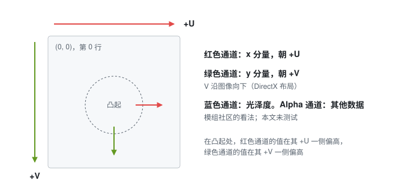

图 1. 法线贴图的布局。在凸起处，红色在其 +U 一侧偏高，绿色在其 +V 一侧偏高。

### B. 原版切线坐标系

FLVER 网格的每个顶点存储一条切线 $\vec{T}$ 和一个副切线符号 $W$（bitangent sign），取 $+1$ 或 $-1$。在游戏的原生（原版）模型上，$\vec{T}$ 沿所存储 UV 的 +V，与 $\vec{N}$ 正交。副切线并不存储，而是由下式给出：

$$
\vec{B} = W\,(\vec{N}\times\vec{T}) \tag{6}
$$

*文字表述：* 副切线是法线与切线的叉积，W 为 −1 时方向反转。W 的取值使副切线指向 +U。

二者的角色与 (1) 相反：在 (1) 中 $\vec{T}$ 沿 +U、$\vec{B}$ 沿 +V，而在游戏的约定中 $\vec{T}$ 沿 +V、$\vec{B}$ 沿 +U。游戏沿 $\vec{T}$ 读取绿色，沿 $\vec{B}$ 读取红色：

$$
\vec{n} = \frac{x\,\vec{B} + y\,\vec{T} + z\,\vec{N}}{\lVert x\,\vec{B} + y\,\vec{T} + z\,\vec{N}\rVert} \tag{7}
$$

*文字表述：* 着色法线是以 x、y、z 为权重的副切线（+U）、切线（+V）和法线的线性组合，再经归一化。归一化是常见做法，但在艾尔登法环中未确认，原因见第 III-A 节。

一个 UV 岛所需的 $W$ 值取决于网格的形状。记 $\vec{p}(u, v)$ 为表面上 UV 位置 $(u, v)$ 处的点，$\vec{a} = \partial\vec{p}/\partial u$ 和 $\vec{b} = \partial\vec{p}/\partial v$ 为位置沿 +U 和 +V 的偏导数。法线为
$\vec{N} = s\,(\vec{a}\times\vec{b})/\lVert\vec{a}\times\vec{b}\rVert$，其中 $s = \pm 1$，且
$\vec{T} = \vec{b}/\lVert\vec{b}\rVert$。恒等式

$$
(\vec{a}\times\vec{b})\times\vec{b} = (\vec{a}\cdot\vec{b})\,\vec{b} - (\vec{b}\cdot\vec{b})\,\vec{a} \tag{8}
$$

*文字表述：* 将 $\vec{a}\times\vec{b}$ 再与 $\vec{b}$ 作叉积，除去沿 $\vec{b}$ 的分量外，得到切平面内一个与 $\vec{a}$ 方向相反的向量。

给出 $\vec{N}\times\vec{T} \propto -s\,\vec{a}$（除去沿 $\vec{T}$ 的分量）。要使 $W(\vec{N}\times\vec{T})$ 指向 +U，$W$ 必须为 $-s$：

$$
W = -\operatorname{sign}\!\left(\vec{N}\cdot\left(\frac{\partial\vec{p}}{\partial u}\times\frac{\partial\vec{p}}{\partial v}\right)\right) \tag{9}
$$

*文字表述：* 当法线与沿 +U、+V 的偏导数之叉积的点积为正时，W 为 −1；为负时，W 为 +1。镜像 UV 岛会使该叉积反向，因此其 W 相反（图 2）。

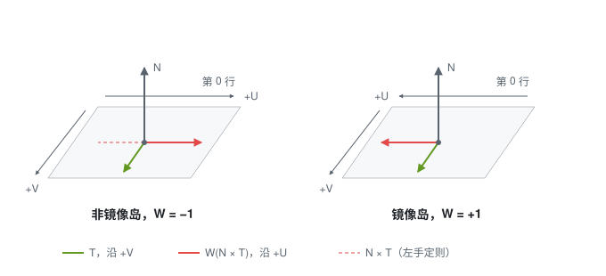

图 2. 非镜像岛与镜像岛上的切线坐标系，透视图。虚线箭头是应用 $W$ 之前的 $\vec{N}\times\vec{T}$。

### C. FLVER 空间的手性

**问题。** FLVER 空间是左手坐标系还是右手坐标系？FLVER 文件并未说明。

**意义。** 手性决定游戏内所见的 $\vec{N}\times\vec{T}$ 指向哪一边，从而决定纹理看起来未镜像的 UV 岛需要哪个 $W$ 值。

**检验方法。** 利用一个原版模型（面部部件 FC_F_0000）的两个性质：其解剖结构确定手性，其环绕顺序与之一致。

- **解剖结构：** 角色沿 +Y 站立，面朝 −Z，左侧在 +X。从正面看，x 向右，y 向上，z 指向屏幕内。按 FBX SDK 的术语，这是左手坐标系，与其 DirectX 预设相同 [2]。
- **环绕顺序：** 用 (2) 计算，$(\vec{p}_1-\vec{p}_0)\times(\vec{p}_2-\vec{p}_0)$ 在 LOD0（最精细的细节层级）几乎所有三角形上都与所存储的法线方向相反。若所存储的法线朝外，则正面按右手坐标系计算为顺时针，在左手坐标系中看则为逆时针。

**结果。** FLVER 空间是左手坐标系，因此游戏内所见的 $\vec{N}\times\vec{T}$ 遵循左手定则。在纹理于游戏内看起来未镜像的 UV 岛上，$\vec{N}\times\vec{T}$ 指向 −U，(6) 需要 $W = -1$。该检验有其局限：仅一个模型、仅 LOD0，手性由解剖结构和环绕顺序推断。

**对实现的影响。** 式 (9) 以及第 VI 节的导入步骤 ER Tangents（通过 (19)）在非镜像岛上给出 $W = -1$。Blender 场景交换 Y 轴与 Z 轴后进入该空间（图 3(a) 和 (b)）：先绕 X 轴旋转 −90°，将 Blender 的上方（+Z）转到 +Y、前方（−Y）转到 +Z，再将 Z 取反，使前方变为 −Z。这一交换是反射（行列式为 −1），它把 Blender 的右手坐标系转为左手坐标系的 FLVER 空间，而角色的左侧仍在 +X。


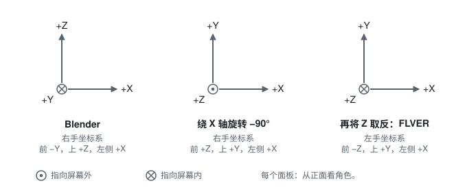

图 3. 从 Blender 到 FLVER 空间的坐标轴交换。(a) 动画：角色的坐标经绕 X 轴的旋转和 Z 的取反，坐标轴固定，按 Blender 前视图的方向绘制。(b) 从角色正面看每个阶段，其左侧在右边；带点的圆圈表示指向屏幕外，带叉的圆圈表示指向屏幕内。

## IV. 测量

### A. 可积性检验

**问题。** 游戏的法线贴图是否以 DirectX 布局存储：红色对应 U，绿色对应 V，且绿色未反转？

**意义。** 布局决定哪个通道存储切线空间法线的哪个分量，从而决定游戏必须沿切线坐标系的哪个向量读取哪个通道。布局错误会使红绿互换，或使绿色反转。

**检验方法。** 贴图存储的是同一高度场的导数，而高度场的混合偏导数相等。只有通道与 UV 轴配对正确、相对符号也正确时，这一点才成立，因此每张贴图自身就能显示其布局，无需运行游戏。

对任何光滑的高度场，混合偏导数相等（施瓦茨定理）：

$$
\frac{\partial}{\partial v}\!\left(\frac{\partial h}{\partial u}\right) = \frac{\partial}{\partial u}\!\left(\frac{\partial h}{\partial v}\right) \tag{10}
$$

*文字表述：* $\partial h/\partial u$ 沿 V 的变化率等于 $\partial h/\partial v$ 沿 U 的变化率。

导数较小时，(3) 和 (5) 给出 $x \approx -\partial h/\partial u$ 和 $y \approx -\partial h/\partial v$，因此采用假定布局的贴图必须满足

$$
\frac{\partial R}{\partial v} \approx \frac{\partial G}{\partial u} \tag{11}
$$

*文字表述：* 红色沿 V（沿图像向下）的偏导数与绿色沿 U（横向）的偏导数相符。

两边均用中心差分计算，再在贴图中细节较多的一半像素上求二者的皮尔逊相关系数；细节较多的像素，指红色和绿色四个偏导数的绝对值之和高于中位数的像素。另一种配对，即红色对 V、绿色对 U（交换配对），以同样方式比较 $\partial R/\partial u$ 与 $\partial G/\partial v$。相关系数绝对值较大的配对胜出，该相关系数的符号表明绿色相对于红色是否反转。贴图的结果由整张贴图得出。256 × 256 像素的图块只用于判断贴图是否有可检验的细节：当两个通道的标准差都低于 0.03（通道值取 0 到 1）时，跳过该图块。当某个通道完全不变化，或所有图块都被跳过时，贴图不可检验。

该检验在 1,437 张法线贴图上运行，每个文件名一张，取自为本文安装的游戏部件文件；其中 50 张不可检验。检验的脚本和逐张贴图的结果随本文公开 [5]；复现它们需要游戏本身的文件，这些文件不随本文分发。按文件名前缀、在可检验的贴图上统计（表 I）：

表 I 游戏部件法线贴图的布局检验，按文件名前缀

| 前缀       | 可检验贴图 | 不可检验 | DirectX 配对，符号为正 | 相关系数中位数，DirectX | 相关系数中位数，交换 |
| ---------- | ---------- | -------- | ---------------------- | ----------------------- | -------------------- |
| WP（武器） | 535        | 2        | 98.3%                  | 0.54                    | 0.23                 |
| BD（身体） | 247        | 2        | 96.8%                  | 0.54                    | 0.24                 |
| HD（头部） | 226        | 0        | 96.0%                  | 0.55                    | 0.26                 |
| LG（腿部） | 151        | 0        | 98.7%                  | 0.50                    | 0.21                 |
| AM（手臂） | 124        | 0        | 97.6%                  | 0.51                    | 0.21                 |
| FG         | 47         | 39       | 85.1%                  | 0.46                    | 0.27                 |
| AA         | 36         | 7        | 94.4%                  | 0.56                    | 0.33                 |
| FC         | 17         | 0        | 100.0%                 | 0.48                    | 0.26                 |
| HR         | 3          | 0        | 100.0%                 | 0.43                    | 0.21                 |
| HA         | 1          | 0        | 100.0%                 | 0.39                    | 0.20                 |

**结果。** 在 1,387 张可检验贴图中的 1,347 张（97%）上，“红色对 U、绿色对 V、符号相同”的配对（V 向下）以正相关胜出（图 4）。该配对即 DirectX 布局。相关程度中等，并不强：其中位数为 0.53，而交换配对为 0.24。在其余 40 张贴图上，检验选出的是绿色反转（32 张）或交换配对（8 张）。从中抽取 4 张，在上方光源下着色观察，按 DirectX 布局读取时看起来都是凸起的，因此该检验很可能误判了这 4 张贴图；其余未作调查。该检验有两个局限：

- 红色和绿色同时反转的贴图相关系数不变，因此该检验确定的是配对以及绿色相对于红色的符号，整体符号则由游戏内测试（IV-C）确定；
- 它检验的是贴图如何制作，而非游戏如何读取。

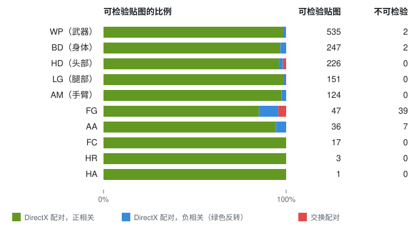

图 4. 游戏部件法线贴图的布局检验：按文件名前缀，各结果所占可检验贴图的比例：以正相关或负相关胜出的 DirectX 配对，或交换配对。

**对实现的影响。** DirectX 布局是 (3) 所解码的布局，也是通道变换 (20) 和 (21) 的出发点。该检验在游戏的各张贴图上佐证了游戏内测试（IV-C）；仅凭它不能确定布局。

### B. 原版切线坐标系

**问题。** 游戏原版模型存储的是什么切线坐标系：$\vec{T}$ 是否沿 +V，$W$ 是否由 (9) 给出？

**意义。** 游戏通过所存储的切线坐标系读取每张贴图，因此导入器必须写出游戏模型所带的切线坐标系。

**检验方法。** 网格所隐含的切线坐标系仅由其位置和 UV 决定，见第 VI 节的 (15) 和 (16)。
在每个三角形角点上将其与所存储的切线坐标系比较，即可看出所存储的切线坐标系遵循哪条规则。

共检查 1,515 个部件模型：即为本文安装的游戏部件文件中所有带三角形、切线和 UV 的模型。每个模型都用 SoulsFormatsNEXT [1]（TKGP 的 SoulsFormats 的社区后续版本）读取：对每个网格，读取每个顶点的位置、法线、第一条切线 $(\vec{T}, W)$ 和第一组 UV，以及 LOD0 面集的三角形。然后逐三角形检查：

- 式 (15) 和 (16) 给出 $\partial\vec{p}/\partial u$ 和 $\partial\vec{p}/\partial v$；跳过退化三角形和在 UV 空间中没有面积的三角形；
- 在三角形的三个顶点上，将所存储的切线坐标系与之比较：
  - $W$ 的值；
  - $\vec{T}$ 的长度；
  - $|\hat{T}\cdot\hat{N}|$，切线与法线正交时为 0；
  - $\vec{T}$ 与去掉沿 $\vec{N}$ 分量后的 $\partial\vec{p}/\partial v$ 之间的余弦，切线沿 +V 时为 1；
  - $W$ 是否等于 (9)。

该检查、它对每个网格的调查以及逐网格的结果都随本文公开 [5]，该检查也用本文的其他公式做了测试。三角形的 UV 朝向是 $d$ 的符号，$d$ 为其 UV 差的行列式，见第 VI 节的 (15)。对于任何边为 $\vec{e}_1$ 和 $\vec{e}_2$ 的三角形，由 (14) 和 (15) 得
$\vec{e}_1\times\vec{e}_2 = d\,(\partial\vec{p}/\partial u\times\partial\vec{p}/\partial v)$，因此 $d$ 的符号只有与环绕顺序结合才能区分镜像与非镜像。在游戏的环绕顺序下（III-C），
$\vec{N}\cdot(\vec{e}_1\times\vec{e}_2) < 0$，因此 $\vec{N}\cdot(\partial\vec{p}/\partial u\times\partial\vec{p}/\partial v)$
与 $d$ 符号相反。非镜像岛由 (9) 得 $W = -1$，该点积为正。因此
$d > 0$ 对应镜像岛，$d < 0$ 对应非镜像岛。表 II 按文件名前缀统计：(9) 的成立比例按 UV 朝向分列，并对所有角点汇总；其余各列给出该前缀下各部件的范围、最大值和最小值：

表 II 游戏部件模型所存储的切线坐标系，按文件名前缀

| 前缀       | 部件 | 检查的三角形顶点 | $\vec{T}$ 的长度 | $\lvert\hat{T}\cdot\hat{N}\rvert$，第 99 百分位数的最大值 | 与 +V 的余弦中位数的最小值 | (9) 成立，$d > 0$ | (9) 成立，$d < 0$ |
| ---------- | ---- | ---------------- | ------------------ | ----------------------------------------------------------- | -------------------------- | ------------------- | ------------------- |
| WP（武器） | 575  | 7,303,518        | 0.987 至 1.014     | 0.032                                                       | 0.961                      | 99.45%              | 99.75%              |
| BD（身体） | 334  | 21,370,163       | 0.986 至 1.013     | 0.016                                                       | 0.965                      | 92.08%              | 99.77%              |
| HD（头部） | 217  | 7,071,393        | 0.987 至 1.014     | 0.024                                                       | 0.943                      | 91.06%              | 99.67%              |
| LG（腿部） | 155  | 6,719,632        | 0.987 至 1.013     | 0.024                                                       | 0.974                      | 98.61%              | 99.70%              |
| AM（手臂） | 127  | 2,640,579        | 0.987 至 1.013     | 0.016                                                       | 0.970                      | 99.78%              | 99.85%              |
| FG         | 56   | 443,421          | 0.987 至 1.013     | 0.024                                                       | 0.974                      | 99.62%              | 99.75%              |
| HR         | 36   | 5,812,887        | 0.987 至 1.014     | 0.016                                                       | 0.921                      | 99.40%              | 99.61%              |
| FC         | 15   | 1,106,208        | 0.987 至 1.013     | 0.016                                                       | 0.994                      | 99.83%              | 99.84%              |

**结果。** 在全部 1,515 个部件上，$W$ 恰好为 $+1$ 或 $-1$，$\vec{T}$ 的长度在存储精度内为单位长度（0.986 至 1.014）。在每个部件 99% 的角点上，$\vec{T}$ 与 $\vec{N}$ 正交，误差约在 2° 以内，且沿平面内的 +V 方向：余弦中位数在 76% 的部件上至少为 0.99，除 2 个部件外都至少为 0.95（最低为 0.92，在 HR_A_0115 上）。有 1,422 个部件同时含有两种 UV 朝向。

式 (9) 在两种 UV 朝向上都成立，只有一类网格例外：材质名称包含“cloth”的网格（表 III）。

表 III (9) 成立的情况：布料网格与其他网格

| 网格                  | 检查的网格 | 部件  | (9) 成立，$d > 0$ | (9) 成立，$d < 0$ |
| --------------------- | ---------- | ----- | ------------------- | ------------------- |
| 材质名称包含“cloth” | 1,612      | 490   | 1.39%               | 99.73%              |
| 其他所有              | 8,033      | 1,515 | 99.65%              | 99.73%              |

在所查看的 4 个部件的 17 个布料网格上，无论 UV 朝向如何，每个顶点的 $W$ 都为 $-1$，而 $\vec{T}$ 仍沿 +V，因此 (9) 在其镜像岛上不成立。模组社区已知，这类材质标记的是由布料模拟而非骨骼驱动的网格；这些网格为何保持 $W = -1$ 未作调查，游戏是否对其使用 $W$ 也未测试。在布料材质之外，有 43 个网格在超过 5% 的角点上不满足 (9)；未作调查。武器 WP_A_1253 的 UV 大多为非镜像，多数顶点带有 $W = -1$，即 (9) 在非镜像岛上给出的值。

导入器看到的是每个网格所用的材质文件（游戏的 matxml 文件，由网格的材质指定），而非其材质名称。对含有 $d > 0$ 角点的网格：若这些角点中至少 95% 不满足 (9)，记为“保持 $W = -1$”；若至少 95% 满足，记为“遵循 (9)”；否则记为“混合”。若材质文件包含“cloth”且保持 $W = -1$，或材质文件不含“cloth”且遵循 (9)，则记为“一致”（表 IV）：

表 IV 网格在镜像角点上如何存储 W，按材质文件

| 材质文件      | 网格  | 保持 $W = -1$ | 遵循 (9) | 混合 | 一致，按网格 | 一致，按角点 |
| ------------- | ----- | --------------- | -------- | ---- | ------------ | ------------ |
| 包含“cloth” | 854   | 820             | 3        | 31   | 96.0%        | 98.1%        |
| 其他所有      | 6,345 | 45              | 6,116    | 184  | 96.4%        | 99.5%        |

材质文件与材质名称在是否包含“cloth”上有 22 个网格不一致；其中 21 个由材质文件正确预测了切线坐标系。263 个不一致的网格共含 97,170 个 $d > 0$ 的角点（此类角点共 16,729,648 个）。其中 192 个网格的这类角点少于 30 个。无布料材质文件且 $d > 0$ 角点不少于 300 个的混合网格共 22 个，它们在 $d > 0$ 的角点上至少有 83% 满足 (9)。在它们 $d < 0$ 的角点上，(9) 成立的比例几乎相同（中位数相差 2 个百分点，最多相差 12 个百分点），因此它们看起来是精度不足，而不像布料。FC_M_0105 上有一个使用布料材质文件的大型网格，在其全部 4,806 个 $d > 0$ 的角点上都遵循 (9)。该规则未作进一步调查。

这些测量确定了布料网格之外所存储的切线坐标系：$\vec{T}$ 沿 +V，$W$ 使
$W(\vec{N}\times\vec{T})$ 指向 +U。游戏沿哪个方向读取哪个通道，由另外两个结果得出。可积性检验（IV-A）将红色与 U、绿色与 V 配对，游戏内测试（IV-C）通过所存储的切线坐标系确定整体符号。因此绿色沿 $\vec{T}$ 读取，红色沿 $W(\vec{N}\times\vec{T})$ 读取，即 (7)。

**对实现的影响。** ER Tangents 沿 +V 构建 $\vec{T}$，并由 (19) 确定 $W$；在顶点周围各三角形一致之处，(19) 与 (9) 给出相同的值。在布料网格的镜像岛上，ER Tangents 写出 $W = +1$，而游戏原版模型保持 $-1$；其在游戏内的效果未测试。一个可选的导入步骤可以将使用布料材质的网格的每条切线都设为 $W = -1$，与游戏几乎所有的布料网格一致。名称规则有例外，因此该步骤将在每次导入时选择，而不按材质名称应用；该步骤也未在游戏内测试。

### C. 游戏内测试

**问题。** 游戏是否按 IV-A 和 IV-B 所示读取贴图：DirectX 布局，绿色沿 $\vec{T}$，红色沿 $W(\vec{N}\times\vec{T})$，从而凸起的形状看起来凸起？

**意义。** IV-A 和 IV-B 测量的是文件；只有游戏才能显示它如何读取这些文件。IV-A 还没有确定整体符号。

**检验方法。** 同样的凸起形状以两种编码并排放置，在同一光源下：只有游戏按预期读取的编码看起来凸起。

为一个原版身体部件 BD_M_1730 赋予一张测试贴图，其各行交替使用同一组凸起形状的两种编码：DirectX，以及绿色反转的 DirectX。部件的反照率为各行着色，DirectX 行为暖色，绿色反转的行为冷色。

**结果。** 在游戏内（图 5），光源位于上方时，只有 DirectX 行看起来凸起，其亮面朝向光源；绿色反转的行看起来凹陷。两种编码只在绿色上不同，因此这确定了沿 $\vec{T}$ 读取的绿色的整体符号；结合 IV-A 的配对，它确认了布局和切线坐标系。

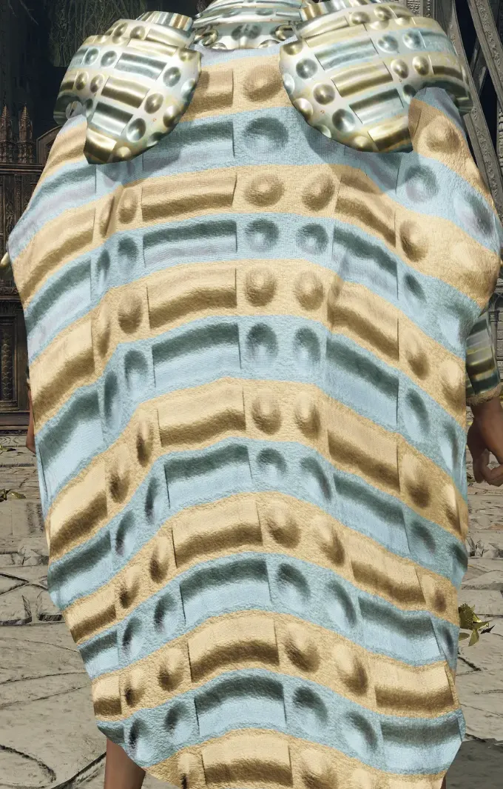

图 5. BD_M_1730 上的游戏内测试。暖色行：DirectX 编码，凸起。冷色行：绿色反转，凹陷。

**对实现的影响。** 它确认了 (7)，ER Tangents 和第 VII 节的通道变换都依赖于此。

### D. 导入测量

**问题。** 不使用 ER Tangents 时，导入器写出的是什么切线坐标系？

**意义。** 它与原版切线坐标系（IV-B）的差异，正是本文要消除的错误。

**检验方法。** 取一个测试平面，其 UV 一半非镜像、一半镜像，分两次导入：一次无镜像，一次 Z 轴镜像，并读回每次导入所存储的切线坐标系。该平面的文件不含切线，因此导入器用 FBX SDK 生成切线。

**结果。** 在两次导入中，两半上的切线都指向 +U，$W$ 在一半上为 $-1$，在另一半上为 $+1$。

- 无镜像时，非镜像的一半上 $W = -1$，两半都沿 −V 读取红色。
- Z 轴镜像时，非镜像的一半上 $W = +1$，两半都沿 +V 读取红色。

每一半都按导入后的状态命名。

因此在每次导入中，两半的读取方式相同。该检验有其局限：仅一个测试平面，切线由导入器生成而非由文件携带。

**对实现的影响。** 这些切线坐标系给出 (12) 和 (13)，即旋转和反射：ER Tangents 消除的正是它们，第 VII 节的通道变换则改为抵消它们。二者在镜像岛和非镜像岛上都成立。

## V. 通用约定下的切线

FBX SDK 为不含切线的文件生成的切线 [2] 指向 +U，见第 IV-D 节的测量。FBX 文件自带的切线遵循通用约定，例如 Blender 的切线（第 VI 节），本文未对其测量。导入器原样保留这些切线。记 $\hat{u}$ 和 $\hat{v}$ 为切平面内沿 +U 和 +V 的单位向量，$\vec{T}'$、$W'$ 和 $\vec{B}'$ 为导入器写出的切线坐标系中的切线、副切线符号和副切线。按 IV-D 中测得的切线坐标系，它们为

$$
\vec{T}' = \hat{u}, \qquad
\vec{B}' = W'\,(\vec{N}\times\hat{u}) = \begin{cases} -\hat{v} & \text{无镜像} \\ +\hat{v} & \text{Z 轴镜像} \end{cases} \tag{12}
$$

*文字表述：* 使用沿 +U 的切线时，绿色沿 +U 读取，红色沿 −V（无镜像）或 +V（Z 轴镜像）读取（图 6）。

镜像使红色从 −V 转为 +V。对 z 取反同样会反射法线、切线和偏导数，而反射会使每个叉积反向，因此 $\vec{N}\times\hat{u}$ 相对于随之反射的 +V 反向。反射还会使每个 UV 岛在镜像与非镜像之间互换，而每个顶点保留镜像之前生成的 $W'$。这正是 IV-D 的发现：$W = -1$ 的那一半，无镜像时是非镜像的一半，Z 轴镜像时是镜像的一半。

设制作时某切线空间法线的 (x, y) 分量为 $(a, b)$（$a$ 朝 +U，$b$ 朝 +V），其本意是切平面内的方向 $a\,\hat{u} + b\,\hat{v}$。按 (7)，游戏将其读作 $a\,\vec{B}' + b\,\vec{T}'$，用 $(U, V)$ 分量表示为

$$
\begin{pmatrix} b \\ -a \end{pmatrix} = \begin{pmatrix} 0 & 1 \\ -1 & 0 \end{pmatrix}\begin{pmatrix} a \\ b \end{pmatrix} \ \text{（无镜像）}, \qquad
\begin{pmatrix} b \\ a \end{pmatrix} = \begin{pmatrix} 0 & 1 \\ 1 & 0 \end{pmatrix}\begin{pmatrix} a \\ b \end{pmatrix} \ \text{（Z 轴镜像）} \tag{13}
$$

*文字表述：* 无镜像时，每个切线空间法线的 (x, y) 分量在贴图上逆时针旋转 90°（从 +U 转向 −V）；Z 轴镜像时，它们关于直线 U = V 反射。于是凸起的圆顶要么像是从侧面照亮，要么在 U = V 对角线上凸起、在 U = −V 对角线上凹陷，沿 U 和 V 则像是从侧面照亮（图 7）。

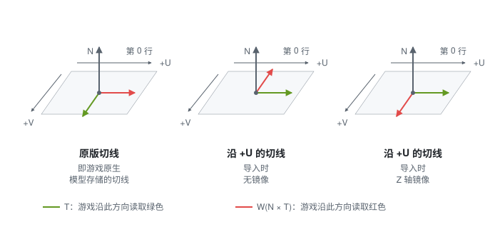

图 6. 游戏读取绿色和红色的方向，分别对应原版切线和沿 +U 的切线。

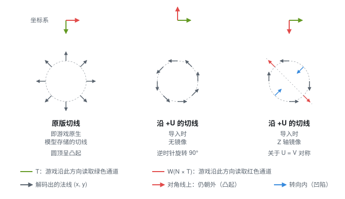

图 7. 动画：每种情况下凸起圆顶周围解码出的切线空间法线。

## VI. ER Tangents

ER Tangents 是一个按游戏约定构建切线的导入步骤 [6]。启用该步骤时，导入器在坐标轴变换之后依据网格构建切线，取代文件中的切线。该步骤改编自 Lengyel 的方法 [7]：逐三角形计算切线，逐顶点取平均，相对法线做正交化（格拉姆-施密特），并将手性存为 ±1。这里切线沿 +V 而非 +U，且每个三角形贡献的是按其面积加权的归一化方向。步骤如下。

**逐三角形。** 跳过有重复顶点的退化三角形。对于顶点
$\vec{p}_0, \vec{p}_1, \vec{p}_2$，其 UV 为 $(u_i, v_i)$，边为 $\vec{e}_1 = \vec{p}_1 - \vec{p}_0$ 和
$\vec{e}_2 = \vec{p}_2 - \vec{p}_0$，UV 差为 $\Delta u_1 = u_1 - u_0$、$\Delta v_1 = v_1 - v_0$，
$\Delta u_2$、$\Delta v_2$ 同理。在平面三角形上，位置随 UV 线性变化：

$$
\vec{e}_1 = \Delta u_1\,\frac{\partial\vec{p}}{\partial u} + \Delta v_1\,\frac{\partial\vec{p}}{\partial v}, \qquad
\vec{e}_2 = \Delta u_2\,\frac{\partial\vec{p}}{\partial u} + \Delta v_2\,\frac{\partial\vec{p}}{\partial v} \tag{14}
$$

*文字表述：* 每条边都是沿 +U 和 +V 的偏导数的线性组合，以该边的 UV 差为权重。

$$
d = \Delta u_1\,\Delta v_2 - \Delta u_2\,\Delta v_1 \tag{15}
$$

*文字表述：* d 是 UV 差的行列式：三角形在 UV 空间中带符号面积的两倍。d 为零或接近零时，三角形在 UV 空间中没有面积，予以跳过。

$$
\frac{\partial\vec{p}}{\partial u} = \frac{\Delta v_2\,\vec{e}_1 - \Delta v_1\,\vec{e}_2}{d}, \qquad
\frac{\partial\vec{p}}{\partial v} = \frac{\Delta u_1\,\vec{e}_2 - \Delta u_2\,\vec{e}_1}{d} \tag{16}
$$

*文字表述：* 由 (14) 解出两个偏导数，即得到该三角形上 U 和 V 增大的方向。

**逐顶点。** 每个三角形将两个偏导数归一化后，以
$\lVert\vec{e}_1\times\vec{e}_2\rVert$（其面积的两倍）加权，累加到它的三个顶点上：

$$
\vec{s}_u = \sum \lVert\vec{e}_1\times\vec{e}_2\rVert\,\frac{\partial\vec{p}/\partial u}{\lVert\partial\vec{p}/\partial u\rVert}, \qquad
\vec{s}_v = \sum \lVert\vec{e}_1\times\vec{e}_2\rVert\,\frac{\partial\vec{p}/\partial v}{\lVert\partial\vec{p}/\partial v\rVert} \tag{17}
$$

*文字表述：* 每个顶点在其周围的三角形上累加 +U 方向的面积加权和 $\vec{s}_u$，以及 +V 方向的面积加权和 $\vec{s}_v$；三角形越大，权重越大。

$$
\vec{T} = \frac{\vec{s}_v - \vec{N}\,(\vec{N}\cdot\vec{s}_v)}{\lVert\vec{s}_v - \vec{N}\,(\vec{N}\cdot\vec{s}_v)\rVert} \tag{18}
$$

*文字表述：* 将累加的 +V 方向去掉沿法线的分量（格拉姆-施密特）并归一化，即得切线。

$$
W = \begin{cases} +1 & \text{若 } (\vec{N}\times\vec{T})\cdot\vec{s}_u \ge 0 \\ -1 & \text{否则} \end{cases} \tag{19}
$$

*文字表述：* 当 $\vec{N}\times\vec{T}$ 与累加的 +U 方向的点积为零或正时，W 为 +1；为负时，W 为 −1，从而 $W(\vec{N}\times\vec{T})$ 始终指向 +U。

**回退。** 若某顶点没有可用的法线，或累加的 +V 方向长度接近零或与法线接近平行，则保留文件或 FBX SDK 给出的切线；该切线第四个分量为负时 W 取 −1，否则取 +1。

**环绕顺序。** 交换顶点 1 和 2 会交换两条边和 UV 差，从而使 $d$ 和 (16) 中两个分子的符号都反转。方向和 $\lVert\vec{e}_1\times\vec{e}_2\rVert$ 不变，因此任一环绕顺序给出的结果相同。

**算例。** 一个三角形：$\vec{p}_0 = (0, 0, 0)$，$\vec{p}_1 = (2, 0, 0)$，$\vec{p}_2 = (0, 0, 1)$；UV 为
$(0, 0)$、$(0.5, 0)$、$(0, 0.25)$；每个顶点的法线均为 $\vec{N} = (0, -1, 0)$（表 V，图 8）。该三角形的环绕顺序与游戏的相反（III-C）：$\vec{e}_1\times\vec{e}_2$ 指向 $\vec{N}$。因此这里在非镜像岛上 $d > 0$；(9) 和 (19) 对任一环绕顺序给出相同的 $W$。

表 V 一个三角形的算例

| 量                                        | 值                           |
| ----------------------------------------- | ---------------------------- |
| $\vec{e}_1$, $\vec{e}_2$              | $(2, 0, 0)$, $(0, 0, 1)$ |
| 由 (15) 得 $d$                          | $0.125$                    |
| 由 (16) 得 $\partial\vec{p}/\partial u$ | $(4, 0, 0)$                |
| 由 (16) 得 $\partial\vec{p}/\partial v$ | $(0, 0, 4)$                |
| 由 (18) 得 $\vec{T}$                    | $(0, 0, 1)$                |
| 由 (2) 得 $\vec{N}\times\vec{T}$        | $(-1, 0, 0)$               |
| 由 (19) 及 (9) 得 $W$                   | $-1$                       |
| 由 (6) 得 $\vec{B}$                     | $(1, 0, 0)$，沿 +U         |

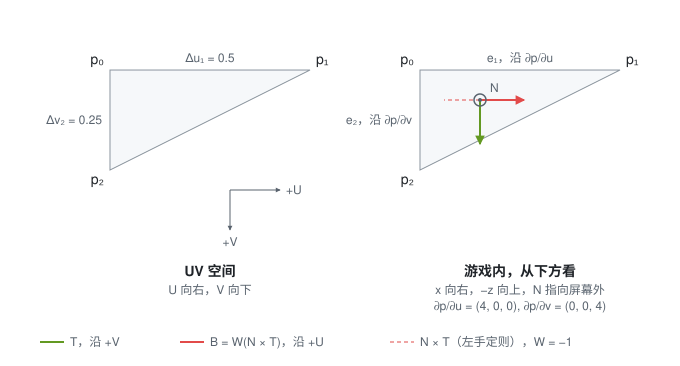

图 8. 算例中的三角形，分别位于 UV 空间和游戏内，从下方看，$\vec{N}$ 指向屏幕外。切线沿 +V，$W = -1$ 将 $\vec{N}\times\vec{T}$ 转到 +U。

**验证。** ER Tangents 按以下方式检验。

**问题。** 使用 ER Tangents 的导入是否带有游戏的切线坐标系？

**意义。** ER Tangents 是本文提出的修复方法；在检验之前，它只是推导结果。

**检验方法。** 四项检验 [6]，从文件到游戏：

- 在原版部件上，重新计算的切线与所存储的切线指向几乎相同；
- 使用 ER Tangents 的导入在两半 UV 上都遵循游戏的切线坐标系，无镜像和 Z 轴镜像时皆然；
- 不使用 ER Tangents 时，导入器写出的内容与上游版本完全相同；
- 在游戏内，一个使用 ER Tangents 导入的平面与一个未使用的平面，与测试贴图并排放置（图 9）：只有使用 ER Tangents 的平面两半看起来一致。

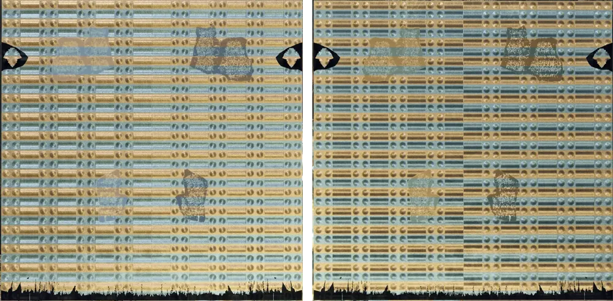

图 9. ER Tangents 的游戏内检验。左：使用 ER Tangents，两半 UV 看起来一致。右：未使用 ER Tangents，两半不一致。

**结果。** 四项检验结论一致。在文件中，使用 ER Tangents 的导入在两半 UV 上都带有原版切线坐标系，无镜像和 Z 轴镜像时皆然；不使用它的导入与导入器此前写出的相同。在游戏内，使用 ER Tangents 的平面两半看起来一致；其导入所用的镜像设置未作记录。不使用 ER Tangents 时，两半在贴图上以相同的旋转或反射读取（IV-D），但镜像的一半显示的是镜像后的贴图，因此两半看起来不同。这一解释由 (13) 推导得出，未单独测试。

**对实现的影响。** 该导入步骤可与任一镜像设置配合使用，不使用它的导入保持不变。

**与 MikkTSpace 的关系。** MikkTSpace [8]、[9] 是 Blender 使用的切线计算方法：Blender 的 `Mesh.calc_tangents` 调用它 [9]，开启 Tangent Space 时 Blender 的 FBX 导出器会调用 `calc_tangents`。这些切线沿 +U，导出器不写 W，因此它们与 FBX SDK 的切线一样遵循通用约定。ER Tangents 依据网格构建自己的切线并忽略文件中的切线，因此从 Blender 导出的两条途径给出相同的切线坐标系，例外是回退顶点，它们保留文件中的切线。

## VII. 改为让贴图匹配切线

不使用 ER Tangents 时，也可以修改贴图，使经 (13) 读出的结果符合制作意图。无镜像时，存储分量为 $(a', b')$ 的切线空间法线读作 $(b', -a')$，因此存储 $a' = -b$、$b' = a$ 即可得回 $(a, b)$。结合 (3)：

$$
R' = 1 - G, \qquad G' = R \tag{20}
$$

*文字表述：* 无镜像时，新的红色为 1 减去原来的绿色，新的绿色为原来的红色。对于 8 位通道，1 减去绿色即 255 减去绿色。

$$
R' = G, \qquad G' = R \tag{21}
$$

*文字表述：* Z 轴镜像时，红色和绿色互换。

蓝色和 Alpha 保持不变。两种变换都由实测的切线坐标系推导得出，未在游戏内测试（图 10）。在由 FBX SDK 生成切线的情况下（如 IV-D），它们同样适用于镜像岛，因为每次导入中两半 UV 的读取方式相同。开启 Tangent Space 时 W 未定义（第 VIII 节），镜像岛不在适用范围内。表 VI 列出了这两种变换。

表 VI 使贴图与沿 +U 的切线相匹配的通道变换

| 导入     | 新的红色  | 新的绿色 |
| -------- | --------- | -------- |
| 无镜像   | 1 − 绿色 | 红色     |
| Z 轴镜像 | 绿色      | 红色     |

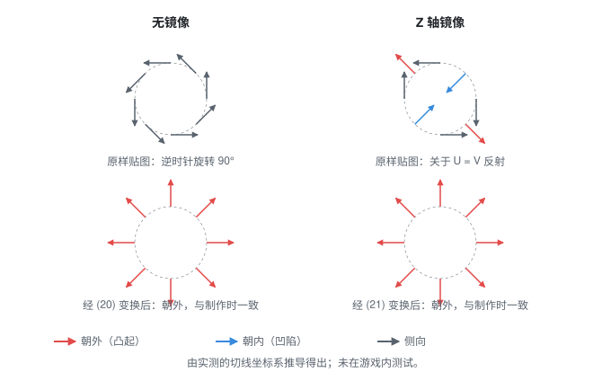

图 10. 经沿 +U 的切线读取时，凸起圆顶周围解码出的切线空间法线，分别为制作时的贴图和经 (20) 或 (21) 变换后的贴图。由推导得出，未在游戏内测试。

## VIII. 实际使用

从 Blender 导出有两条途径（图 11）：其 FBX 导出关闭 Tangent Space 时不写切线，开启 Tangent Space 时写出沿 +U 且没有 W 的切线。不使用 ER Tangents 时，两条途径都得到沿 +U 的切线，因为文件不含切线时导入器会生成切线。使用 ER Tangents 时，两条途径都得到符合游戏约定的 FLVER。开启 Tangent Space 且不使用 ER Tangents 时，W 未定义，因此镜像的 UV 一半也可能读取错误；这一点未测试。

图 11. 从 Blender 导出的途径，以及每条途径给出的切线。

## IX. 局限

- 重建 z（(4)）、归一化（(7)）以及高度关系（(5)）是实时图形中的常见做法。这些做法在艾尔登法环中未确认：游戏的着色器未经检视，也没有游戏内测试能单独验证。
- 蓝色和 Alpha 存储的内容未测试；本文沿用模组社区认为蓝色存储光泽度的看法。
- FLVER 空间的手性由一个模型推断，且仅限 LOD0。
- 布料网格在镜像岛上保持 $W = -1$，与 (9) 和 ER Tangents 不同；其原因和在游戏内的效果未测试。
- 布局检验只在游戏的部件法线贴图上运行。其相关程度中等，在检验不一致的 40 张贴图中，查看了 4 张。
- 第 IV 节所测文件的游戏版本未作记录。
- 不使用 ER Tangents 时镜像与非镜像两半的结果，只从一个测试平面读回。
- 只检查了艾尔登法环；黑暗之魂 3（Dark Souls 3）、只狼（Sekiro）、装甲核心 6（Armored Core 6）和艾尔登法环 黑夜君临（Nightreign）未检查。

## X. 结论

艾尔登法环读取 DirectX 布局的贴图时，沿指向 +V 的切线读取绿色，沿指向 +U 的
$W(\vec{N}\times\vec{T})$ 读取红色。通用约定下的切线指向 +U，因此视镜像设置而定，每个切线空间法线的 (x, y) 分量在贴图上逆时针旋转 90°（从 +U 转向 −V），或关于直线 U = V 反射。依据网格及其 UV 按游戏约定构建切线后，从 Blender 导出的两条途径都能得到游戏的切线坐标系，游戏内检查的平面也呈现预期的着色。在无法使用该步骤时，可以改为交换或反转通道，使贴图匹配切线。

## 致谢

本文与 Anthropic 的 Claude Opus 5.5 合作撰写。Claude 起草了正文和公式，生成了图，并编写了代码和分析：测量脚本、ER Tangents、图生成器及其测试。中文译本同样由 Claude 完成。游戏内测试、测试导入和视觉判断由 shintheweapon 完成。

## 参考文献

[1] soulsmods, "SoulsFormatsNEXT," GitHub repository. [Online]. Available: https://github.com/soulsmods/SoulsFormatsNEXT.
访问日期：2026年11月11日。

[2] Autodesk, *FBX SDK 2020.2.1*, header files `fbxsdk/scene/fbxaxissystem.h` (`FbxAxisSystem`) and
`fbxsdk/scene/geometry/fbxmesh.h` (`FbxMesh::GenerateTangentsDataForAllUVSets`). [Online]. Available:
https://help.autodesk.com/view/FBX/2020/ENU/. 访问日期：2026年11月11日。

[3] J. F. Blinn, "Simulation of wrinkled surfaces," *ACM SIGGRAPH Comput. Graph.*, vol. 12, no. 3, pp. 286-292,
Aug. 1978, doi: 10.1145/965139.507101.

[4] Adobe, "What is the difference between the OpenGL and DirectX normal format?," Substance 3D Bakers documentation,
1 May 2026. [Online]. Available:
https://experienceleague.adobe.com/en/docs/substance-3d/bakers/common-questions/what-is-the-difference-between-the-opengl-and-directx-normal-format.
访问日期：2026年11月11日。

[5] shintheweapon, "blender_flver_prep," GitHub repository, branch develop: `docs/figures/` (the scripts
and results of Sections IV-A and IV-B) and `docs/paper/README.md` (how to reproduce them). [Online].
Available: https://github.com/shintheweapon/blender_flver_prep/tree/develop. 访问日期：2026年11月12日。

[6] shintheweapon, "FbxImporter," fork, branch develop; and "Add an ER Tangents import option," pull request #10.
[Online]. Available: https://github.com/shintheweapon/FbxImporter/tree/develop and
https://github.com/The12thAvenger/FbxImporter/pull/10. 访问日期：2026年11月11日。

[7] E. Lengyel, "Computing tangent space basis vectors for an arbitrary mesh," Terathon Software, 15 Mar. 2004.
[Online]. Available: https://terathon.com/code/tangent.php. 访问日期：2026年11月11日。

[8] M. Mikkelsen, "Simulation of wrinkled surfaces revisited," M.S. thesis, Dept. Comput. Sci. (DIKU), Univ.
Copenhagen, Copenhagen, Denmark, Mar. 2008. [Online]. Available:
http://image.diku.dk/projects/media/morten.mikkelsen.08.pdf. 访问日期：2026年11月11日。

[9] M. S. Mikkelsen, "MikkTSpace," GitHub repository, 2011. [Online]. Available: https://github.com/mmikk/MikkTSpace.
Blender's port: `intern/mikktspace` and `source/blender/blenkernel/intern/mesh_tangent.cc`, Blender 4.5, [Online].
Available: https://github.com/blender/blender. 访问日期：2026年11月11日。
